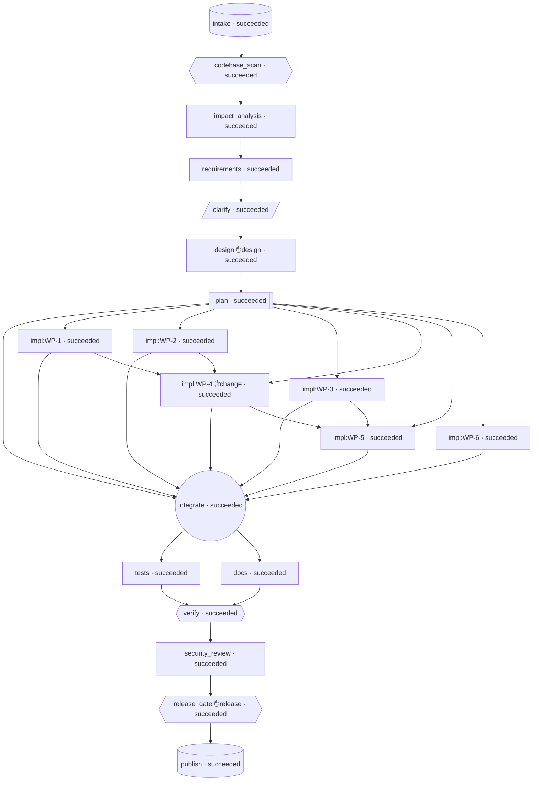

# Engineering Summary — brownfield (run_2e7440e535cd)

**Status:** succeeded  
**Requirement:** Change request CR-142 for the existing URL shortener service:

1. Custom aliases: when creating a link a client may choose its own short code
   (3-32 characters, letters, digits, '-' and '_'). Reserved words (api, docs, redoc, healthz,
   readyz, metrics, openapi.json) are rejected with 422; an alias that is already taken returns 409.
2. Link expiration: creation accepts an optional `expires_at` (ISO-8601, must be in the future).
   Redirecting an expired link returns 410 Gone; link metadata reports whether it is expired.

Bug report BUG-77 (from support): "A link created with an upper-case s

## 1. Requirement understanding
The existing FastAPI/SQLAlchemy URL shortener only issues random 7-character base62 codes, and its links never expire. CR-142 adds two things. First, clients can choose their own short code (alias): 3-32 characters from [A-Za-z0-9_-]. Reserved words give 422 and a taken alias gives 409. Second, links can have an optional future expiry `expires_at`. Redirecting an expired link gives 410 Gone, and link metadata reports whether the link is expired. Both features must be backwards compatible. Existing endpoints, response fields and the 165 existing tests must keep working. The new `links.expires_at` column needs an explicit migration, because startup only runs `create_all`, which never alters existing tables. BUG-77 says upper-case schemes (`HTTP://Example.com`) were rejected and that a `javascript:` URL was once accepted. Investigation shows the current validator accepts upper-case schemes and rejects every `javascript:` variant, so the URL validator has no defect. Regression tests must still lock in the reported inputs. Other defects found during the investigation must be fixed: `metrics` is missing from the reserved list, the lookup format check is base62-only, the idempotency hash covers only the URL, every IntegrityError is treated as a code collision, and the docs wrongly say there is no authentication.

| ID | Requirement | Priority | Verified by tests |
|---|---|---|---|
| FR-1 | Create a link with a custom alias | must | ✅ |
| FR-2 | Reject reserved words as aliases | must | ✅ |
| FR-3 | Alias uniqueness gives 409 | must | ✅ |
| FR-4 | Alias links resolve on every code-addressed endpoint | must | ✅ |
| FR-5 | Accept and validate an optional expires_at at creation | must | ✅ |
| FR-6 | Expired links return 410 Gone on redirect | must | ✅ |
| FR-7 | Link metadata reports expiry state | must | ✅ |
| FR-8 | Explicit, idempotent schema migration for links.expires_at | must | ✅ |
| FR-9 | Idempotency-Key covers alias and expires_at | must | ✅ |
| FR-10 | Add 'metrics' to the reserved code list | must | ✅ |
| FR-11 | BUG-77 regression tests for URL scheme validation | must | ✅ |
| FR-12 | Backwards compatibility and regression protection | must | ✅ |
| FR-13 | OpenAPI response documentation for new cases | should | — |
| FR-14 | Documentation updates, including the stale authentication statements | should | — |

- **NFR-1** (performance): The expiry check on redirect uses the already-loaded link row and adds no extra database query. The existing latency targets still hold: redirect p95 < 50 ms and create p95 < 100 ms on the reference test setup. — _Existing performance test (NFR-4 in the current suite) stays green. A test counting SQL statements (SQLAlchemy event listener) shows GET /{code} issues the same number of queries as before for active, expired and deactivated links._
- **NFR-2** (security): Only http and https target URLs are accepted, in any letter case. Alias and expires_at input is strictly validated. The management endpoints, including alias and expiry creation, stay behind the fail-closed X-API-Key check. Error responses are JSON {"detail": ...} and never contain stack traces. — _BUG-77 regression tests (FR-11), alias and expiry validation tests, tests/test_auth.py, and tests asserting that 409/410/422 bodies contain only `detail` and no traceback text._
- **NFR-3** (reliability): The schema migration is idempotent and safe to run on every startup, against both fresh and pre-CR-142 databases, with no data loss. — _tests/test_migration.py: boot on a legacy SQLite file twice; row count and existing data are preserved and the column is present._
- **NFR-4** (reliability): Alias creation is atomic. Under a uniqueness race exactly one request succeeds, the rest get 409, and no partial rows (link or idempotency record) remain. — _Monkeypatched IntegrityError test on the alias path asserts 409, rollback and zero extra rows in links and idempotency_keys._
- **NFR-5** (maintainability): The layered architecture is preserved. The reserved list has a single source of truth (codes.RESERVED_CODES), or a test asserts that any duplicate equals it. Expiry logic uses an injectable clock. Each new test docstring cites the FR/NFR ids it covers, plus BUG-77 where relevant. Total line coverage stays at or above 95%. — _Architecture tests green, coverage report from pytest-cov ≥ 95%, and a grep of test docstrings for 'Covers:' on all new tests._
- **NFR-6** (maintainability): The schema change and queries stay portable across SQLite, PostgreSQL and MySQL through DATABASE_URL: generic DateTime, literal ANSI DDL, no dialect-specific SQL. — _Static architecture tests (portable sqltypes, literal text()) and a code review of the DDL string._
- **NFR-7** (operability): Startup logs one structured JSON line when the migration adds the column, and nothing or a debug line when no change is needed. Request logs keep their current fields and never include client IPs. — _A test using caplog asserts the migration log line on a legacy DB. Existing logging tests stay green._
- **NFR-8** (privacy): No new personal data is collected or logged. Aliases and expiry timestamps are not written to logs beyond the existing request path logging. — _Code review and the existing logging tests._

## 2. Codebase reasoning (brownfield)
CR-142 adds two things to the layered FastAPI/SQLAlchemy URL shortener: client-chosen aliases (3-32 chars `[A-Za-z0-9_-]`, reserved words give 422, a taken alias gives 409) and optional link expiry (`expires_at`, which must be in the future; redirecting an expired link gives 410; metadata reports `is_expired`). The change touches the create flow: the LinkCreate schema, LinkService.create_link (the code-retry loop, the IntegrityError mapping and the idempotency request hash), code-format checks used by lookup, redirect, stats and delete, the redirect 410 logic, the response schemas, and the `links` table (new nullable `expires_at` DATETIME column). No column change is needed for aliases because `code` is already String(32) with UNIQUE uq_links_code. The schema change has to be explicit because `Base.metadata.create_all` never alters existing tables and there is no migration tooling (OPERATIONS.md says so). If the column is not added on an existing database, every query on `links` fails with 503. BUG-77 investigation: `validate_target_url` (app/schemas/links.py) is correct for both claims. It lower-cases the scheme via urlsplit before checking it against {http, https}, so `HTTP://Example.com` is accepted and stored unchanged. Any `javascript:` URL fails the scheme check (with or without `//`), and leading whitespace or control characters are rejected first. The existing parametrised tests (HTTPS://, HtTp://, javascript:alert(1), JAVASCRIPT://example.com/%0aalert(1)) and the doctest pass: I ran `pytest tests/test_create_and_validation.py --doctest-modules app/schemas/links.py`, exit 0. The baseline suite of 165 tests passes. The URL validator does not reproduce the reported behaviour, so no fix is needed there. Regression tests should still be added for the exact reported inputs and for case and whitespace variants of `javascript:`. Likely explanations for the report: a 401 from the newer API-key auth, input with surrounding whitespace or newlines (rejected by design), or rows written directly to the database (no validation at redirect time). Related real defects found: the reserved list is missing `metrics`; the API.md, OPERATIONS.md, README and CHANGELOG security notes wrongly say there is no authentication; and the existing tests pin `is_valid_code_format` to base62 only, which matters for alias lookup.

**Impacted files:**
- `app/models/link.py` (modify): Add `expires_at: Mapped[datetime | None] = mapped_column(DateTime, nullable=True)` (naive UTC, portable sqltypes.DateTime). `code` String(32) already fits 32-char aliases and keeps UNIQUE uq_links_code, so no other column change. Optionally add a helper property such as `is_expired_at(now)`, keeping the models layer free of app.* imports.
- `app/core/db.py` (modify): Explicit schema migration is needed because create_all does not ALTER the existing `links` table. Suggested: an idempotent `ensure_schema(engine)` that uses sqlalchemy.inspect to check for the `expires_at` column and, if missing, runs the literal DDL `ALTER TABLE links ADD COLUMN expires_at DATETIME NULL` (one literal string, so test_sql_text_only_receives_literal_strings stays green; portable across SQLite, Postgres and MySQL).
- `app/main.py` (modify): Call the migration step in lifespan after Base.metadata.create_all. Router order stays the same (catch-all last).
- `app/schemas/links.py` (modify): LinkCreate: add optional `alias: str | None` (format ^[A-Za-z0-9_-]{3,32}$, 422 on failure) and optional `expires_at: datetime | None` (ISO-8601; naive treated as UTC via _as_utc; must be in the future, else 422). Consider strict parsing so numbers are not coerced to timestamps. LinkCreatedResponse/LinkDetailResponse: add additive fields `expires_at: datetime | None = None` (UTC-normalised) and `is_expired: bool`. Existing fields are unchanged. The reserved-word list cannot be imported from app.services here (architecture test), so either duplicate the list in schemas or check reserved words in the service with a 422 domain error.
- `app/services/codes.py` (modify): Add `metrics` to RESERVED_CODES (required by the CR; also blocks generated codes). Keep `is_valid_code_format` base62-only because tests/test_codes.py asserts `not is_valid_code_format('abc-123')`. Add new helpers instead, e.g. `ALIAS_PATTERN`/`is_valid_alias` (3-32, [A-Za-z0-9_-]) and `is_valid_lookup_code` (1-32, [A-Za-z0-9_-]) for path lookups.
- `app/services/link_service.py` (modify): create_link(url, idempotency_key, alias=None, expires_at=None, now=None). With an alias: run reserved and format checks (422), skip the generated-code retry loop, and map IntegrityError on code to ConflictError 409 ('Alias already in use'), not a retry or 503. Store expires_at as naive UTC. Extend request_hash to cover alias and expires_at while keeping sha256(url) when both are absent, so existing stored keys still replay (backwards compatible). _get_or_404 must use the widened lookup-format check so links with '-' or '_' aliases resolve. resolve_for_redirect and resolve_and_record_click must raise a 410 for expired links (expires_at <= utcnow) with a distinct detail such as 'Link has expired', and record no click. LinkDetail/CreateResult or the API layer must expose is_expired (use an injectable clock for testability).
- `app/services/stats_service.py` (modify): get_stats uses codes.is_valid_code_format and would return 404 for stats of aliases containing '-' or '_'. Switch it to the widened lookup check. Stats should stay available for expired links, as they are for deactivated ones.
- `app/core/errors.py` (modify): Add a 422 domain error (e.g. UnprocessableEntityError, status_code=422) if reserved, alias or expiry rules are enforced in the service layer. Optionally add an expired-link detail constant; GoneError's default detail is 'Link has been deactivated', which is wrong for expired links.
- `app/api/links.py` (modify): create_link passes payload.alias and payload.expires_at to the service and returns the new response fields. get_link adds expires_at and is_expired. OpenAPI `responses` needs updated 409 (alias taken) and 422 (reserved or invalid alias, past expires_at) descriptions.
- `app/api/redirect.py` (modify): Document 410 for expired links in the responses metadata. Behaviour comes from the service (GET and HEAD both return 410 for expired links; no click on GET).
- `tests/test_aliases.py` (add): New tests: valid aliases (boundaries of 3 and 32 chars, '-' and '_') get 201 and can be redirected, looked up, deleted and queried for stats; 2 or 33 chars or bad characters get 422; reserved words (api, docs, redoc, healthz, readyz, metrics, openapi.json, case-insensitive) get 422; a duplicate alias (also against deactivated or expired links, and on an IntegrityError race) gets 409 with nothing persisted; idempotency with an alias (same key with a different alias gives 409, same payload replays).
- `tests/test_expiration.py` (add): New tests: expires_at in the future gets 201 and the field is echoed; past or now gets 422; naive vs offset datetimes normalise to UTC; redirect after expiry (controlled clock or direct DB update) returns 410 JSON with no Location and no click; HEAD returns 410; metadata shows is_expired true/false; stats still work; links without expires_at never expire.
- `tests/test_bug77_url_validation.py` (add): BUG-77 regression tests: `HTTP://Example.com`, `HTTPS://EXAMPLE.COM/Path` get 201 and are stored unchanged. `javascript:alert(1)`, `JavaScript:alert(1)`, `JAVASCRIPT:alert(1)`, `javascript://example.com/%0aalert(1)`, ` javascript:alert(1)`, `\tjavascript:alert(1)`, `java\nscript:alert(1)`, `http:javascript:alert(1)` get 422 with zero rows. Docstrings should cite BUG-77.
- `tests/test_migration.py` (add): Start the app against a SQLite file created with the pre-CR-142 `links` schema (no expires_at) containing a row. Startup must add the column; the old link still redirects with 307, its metadata shows expires_at null and is_expired false, and new links can be created.
- `docs/API.md` (modify): Document alias/expires_at request fields, the expires_at/is_expired response fields, new 409/410/422 cases, the widened `{code}` lookup format ([A-Za-z0-9_-]{1,32}), the request_hash change, and the reserved list. Also fix the stale 'Authentication: none' statement (API key is enforced).
- `docs/OPERATIONS.md` (modify): Data model table (links.expires_at), the explicit migration step (automatic ALTER or manual SQL for DBAs), idempotency request_hash definition, and the stale 'No authentication' security note.
- `CHANGELOG.md` (modify): Add [Unreleased] entries for CR-142 (aliases, expiration, schema change) and BUG-77 (investigated; regression tests added).
- `README.md` (modify): Feature list and security notice (says 'no authentication', which is stale).

**Data flows touched:**
- Create: POST /api/links -> require_api_key -> LinkCreate validation (url via validate_target_url, alias format, expires_at future/UTC) -> LinkService.create_link (Idempotency-Key lookup/replay by request_hash -> alias path: reserved check + single insert, IntegrityError -> 409 | generated path: retry loop) -> LinkRepository.add (flush) -> IdempotencyRepository.add -> commit -> LinkCreatedResponse (+expires_at, is_expired), Location header
- Redirect: GET /{code} -> LinkService.resolve_and_record_click -> lookup-format check -> LinkRepository.get_by_code -> inactive => 410 / expired (expires_at <= utcnow) => 410 -> ClickRepository.add best-effort -> 307
- HEAD /{code} -> LinkService.resolve_for_redirect -> same 404/410 checks, no click
- Metadata: GET /api/links/{code} -> LinkService.get_link_detail -> LinkDetailResponse with expires_at/is_expired computed against current UTC
- Stats/Delete: StatsService.get_stats / LinkService.deactivate -> lookup-format check (must accept alias charset) -> get_by_code
- Startup: create_app lifespan -> Base.metadata.create_all -> NEW explicit migration adding links.expires_at to pre-existing tables

**Existing defects found:**
- BUG-77 not reproducible: upper-case schemes ARE accepted and `javascript:` URLs ARE rejected by the current validator. No code defect in URL validation; regression tests are still required. @ app/schemas/links.py:validate_target_url (lines ~24-58)
- Reserved-word list lacks `metrics`, which CR-142 requires to be reserved. Today a generated code `metrics` would be accepted, and a future /metrics route would be shadowed by or conflict with such a link. @ app/services/codes.py:RESERVED_CODES (line 13)
- The code-format check used for every lookup only allows base62, so links with aliases containing '-' or '_' would be unreachable (404) for redirect, metadata, delete and stats unless a widened check is used. tests/test_codes.py pins the existing function's behaviour, so a new function is needed rather than editing CODE_PATTERN. @ app/services/codes.py:CODE_PATTERN / is_valid_code_format; used in app/services/link_service.py:_get_or_404 and app/services/stats_service.py:get_stats
- Idempotency payload hash covers only the URL. Once alias and expires_at exist, reusing a key with the same url but a different alias or expiry would silently replay the original link instead of returning 409. @ app/services/link_service.py:create_link (`request_hash = hashlib.sha256(url.encode("utf-8")).hexdigest()`)
- Every IntegrityError on link insert is treated as a generated-code collision and retried, ending in 503 'Could not allocate a unique short code'. For a client-chosen alias this would produce wrong statuses (retries with random codes, or 503) instead of 409. @ app/services/link_service.py:create_link retry loop (`except IntegrityError: self.session.rollback(); continue`)
- No schema migration mechanism: startup only runs create_all, which does not add new columns to existing tables. Adding links.expires_at without an explicit migration breaks every links query on existing deployments (503). @ app/main.py lifespan (`Base.metadata.create_all(bind=engine)`); docs/OPERATIONS.md 'Startup' step 3
- GoneError's default detail is specific to deactivation, so reusing it for expired links would return a misleading message. @ app/core/errors.py:GoneError
- Stale documentation says the management API has no authentication, but it is enforced by an API key (require_api_key, fail-closed). @ docs/API.md ('Authentication: none in this release'), docs/OPERATIONS.md Security notes, README.md line 11, CHANGELOG.md 1.0.0 Security

## 3. Plan & decomposition
Waves (parallel groups): [['WP-1', 'WP-2', 'WP-3', 'WP-6'], ['WP-4'], ['WP-5']]

- **WP-1 Domain primitives: 422/expired errors and code rules** → app/core/errors.py, app/services/codes.py (deps: —; succeeded, 1 attempt(s))
- **WP-2 Schema change: Link.expires_at and idempotent startup migration** → app/models/link.py, app/core/db.py, app/main.py (deps: —; succeeded, 1 attempt(s))
- **WP-3 Request/response schemas: alias, expires_at, is_expired** → app/schemas/links.py (deps: —; succeeded, 1 attempt(s))
- **WP-4 Service rules: alias create path, expiry, idempotency hash, widened lookup** → app/services/link_service.py, app/services/stats_service.py (deps: ['WP-1', 'WP-2']; succeeded, 1 attempt(s))
- **WP-5 HTTP layer: pass new fields, map responses, OpenAPI docs, clock wiring** → app/api/links.py, app/api/redirect.py, app/api/deps.py (deps: ['WP-3', 'WP-4']; succeeded, 1 attempt(s))
- **WP-6 Documentation: CR-142, schema migration, BUG-77 findings, auth corrections** → docs/API.md, docs/OPERATIONS.md, README.md, CHANGELOG.md (deps: —; succeeded, 1 attempt(s))

## 4. Architecture decisions
- **ADR-1 Alias format in schema, reserved words in service with codes.RESERVED_CODES** — LinkCreate validates alias type, length and charset (StrictStr, 3-32, [A-Za-z0-9_-]), giving a FastAPI 422 list detail. LinkService rejects reserved aliases case-insensitively via codes.is_reserved, raising UnprocessableEntityError('Alias is reserved'), which gives 422. 'metrics' is added to codes.RESERVED_CODES, so generated codes and aliases share one list.. _Why:_ Schemas may not import app.* (architecture test), so the reserved list cannot be checked there without duplicating it. Keeping it in the service gives one source of truth (NFR-5, R6). The format check in the schema documents the pattern in OpenAPI. _Alternatives:_ Duplicate the reserved list in schemas plus an equality test, Do all alias validation in the service (loses the OpenAPI pattern and the list-style 422)
- **ADR-2 Separate lookup validator instead of widening CODE_PATTERN** — Add codes.is_valid_lookup_code (^[A-Za-z0-9_-]{1,32}$) and use it in LinkService._get_or_404 and StatsService.get_stats. is_valid_code_format stays base62-only.. _Why:_ tests/test_codes.py asserts is_valid_code_format('abc-123') is False (R3). Lookups must accept aliases with '-'/'_'. Malformed codes still get 404 without a query. '-'/'_' codes that do not exist are now valid-but-unknown, which is still 404. _Alternatives:_ Widen CODE_PATTERN (breaks existing tests), Skip the format check on lookup (extra DB queries for garbage paths)
- **ADR-3 Alias path is a single insert, and IntegrityError gives 409** — If alias is given: pre-check get_by_code (friendly 409), then one LinkRepository.add. On IntegrityError: rollback. If an Idempotency-Key was sent and its record now exists, replay it or return 409. Otherwise raise ConflictError('Alias already in use'). codes.generate_code is never called on this path. The generated-code retry loop is unchanged.. _Why:_ Under a uniqueness race exactly one request wins and the rest get 409, never a random code or 503 (FR-3, NFR-4, R4). The unique constraint uq_links_code is the real guarantee. _Alternatives:_ Reuse the retry loop (wrong status), Rely only on the pre-check (racy)
- **ADR-4 Idempotent startup migration with literal DDL in core/db.ensure_schema** — After create_all, ensure_schema(engine) inspects links. If expires_at is missing, it executes text('ALTER TABLE links ADD COLUMN expires_at DATETIME NULL'). On the postgresql dialect only, it executes text('ALTER TABLE links ADD COLUMN expires_at TIMESTAMP NULL'), because PostgreSQL has no DATETIME type. Both are literal strings passed straight to text(). If the ALTER fails with DBAPIError and the column now exists, this is a tolerated concurrent race. Otherwise it logs an error and re-raises. The manual SQL is documented. No Alembic.. _Why:_ create_all never alters tables (R1). Literal text() keeps the static test green. SQLite and MySQL get exactly the DDL in the requirement. The postgresql branch is a deliberate, called-out deviation so that pre-CR-142 Postgres databases actually migrate: DATETIME would fail there with 'type does not exist'. TIMESTAMP is what SQLAlchemy DateTime creates on Postgres anyway. TIMESTAMP is not used everywhere because on MySQL it means TZ conversion and a 2038 limit. _Alternatives:_ Alembic (out of scope, new dependency), Manual SQL only (deploys break until a DBA acts), Single DATETIME literal for all dialects (broken on PostgreSQL), Compile the type via the dialect and format it into SQL (string-built SQL is forbidden)
- **ADR-5 expires_at: ISO-only parsing in schema, future check in service with an injectable clock** — LinkCreate.expires_at: dt.datetime|None with a mode='before' validator that accepts only None, datetime instances, or str matching a strict ISO-8601 date-time regex (rejects int/bool/''/'tomorrow'/date-only/unix strings). Pydantic then parses it (rejecting month 13), and a mode='after' validator normalises it with _as_utc (naive = UTC). LinkService converts to naive UTC and requires expires_at > self.now(). Otherwise it raises UnprocessableEntityError('expires_at must be in the future'). The clock is LinkService(clock=...), which deps fill from app.state.clock (None means models.utcnow, looked up at call time).. _Why:_ Pydantic lax mode accepts numbers and numeric strings as unix time (R9). Strict mode rejects JSON strings under FastAPI's python validation. The schema cannot reach an injectable clock, but the service can, which allows the 'equal to now gives 422' test (R5). _Alternatives:_ Pydantic strict datetime, AwareDatetime (rejects naive input, contradicting Q-4), Future check inside the schema using datetime.now (not controllable in tests)
- **ADR-6 Backwards-compatible idempotency request_hash** — compute_request_hash(url, alias, expires_at_naive_utc) returns sha256(url) when alias and expires_at are both None. Otherwise it returns sha256 of json.dumps({'alias':..., 'expires_at': 'YYYY-MM-DDTHH:MM:SS.ffffffZ' or None, 'url':...}, sort_keys=True, separators=(',',':'), ensure_ascii=False). The idempotency lookup runs before the reserved/future checks, so a retried successful request always replays.. _Why:_ Stored keys keep replaying (R2). Equal instants in different offsets hash the same. Different alias or expiry gives 409. Failed attempts store no record because the record is only added in the same transaction as a successful link insert. _Alternatives:_ Always hash the new canonical payload (breaks legacy keys), Store payload columns (DDL change)
- **ADR-7 Expiry evaluated from the loaded row; deactivation takes precedence** — Link.is_expired_at(now) returns expires_at is not None and expires_at <= now. Redirect and HEAD check `not is_active` first (GoneError, 'Link has been deactivated'), then expiry (LinkExpiredError, 'Link has expired'), before any click insert. is_expired for responses is computed by the service and returned in CreateResult/LinkDetail. is_active is not changed by expiry.. _Why:_ No extra query (NFR-1). Keeps the existing deactivated 410 unchanged (FR-6, Q-3). One clock source for both redirect and metadata. _Alternatives:_ SQL filter on expires_at (extra query or query change), Expiry takes precedence over deactivation
- **ADR-8 Expose HEAD /{code} in OpenAPI** — Change @router.head('/{code}') to include_in_schema=True with responses 307/404/410, so FR-13's 410 documentation covers HEAD.. _Why:_ FR-13 requires HEAD to list 410. Behaviour is unchanged. Existing OpenAPI tests only assert the presence of paths and schemas. _Alternatives:_ Keep HEAD hidden (fails FR-13)

**API contract:**
- `POST /api/links` — Create a short link, optionally with a custom alias and/or an expiry. Requires X-API-Key. Optional header Idempotency-Key (1-255 chars, not blank). Sets Location: /api/links/{code}. A replay sets Idempotent-Replayed: true and returns the original link's current state.
- `GET /api/links/{code}` — Get link metadata (active, deactivated or expired). Requires X-API-Key. {code} accepts ^[A-Za-z0-9_-]{1,32}$. Anything else gives 404 without a DB lookup.
- `DELETE /api/links/{code}` — Soft-delete (deactivate) a link. Idempotent. Works for expired links and aliases containing '-'/'_'. Requires X-API-Key.
- `GET /api/links/{code}/stats` — Click statistics. Works for deactivated and expired links and aliases containing '-'/'_'. Requires X-API-Key.
- `GET /{code}` — Public redirect (catch-all router, registered last). 307 with the exact stored URL in Location (not re-quoted) and Cache-Control: no-store. Records a click best-effort. HEAD /{code} behaves the same but records no click, and is now included in OpenAPI with the same 307/404/410 responses. 404/410 send no Location and record no click.
- `GET /healthz` — Liveness probe (unchanged, not shadowed by /{code})
- `GET /readyz` — Readiness probe (unchanged, not shadowed by /{code})

## 5. Validation
- ✅ **compile** — ok
- ✅ **lint_correctness** — All checks passed!
- ✅ **tests_pass** — 338 passed, 0 failed, 0 errors
- ✅ **coverage** — 99.06% (minimum 80.0%)
- ✅ **api_contract** — 7 contract endpoints implemented
- ✅ **api_contract_extra** — implemented but not in contract: ['HEAD /{}']
- ✅ **requirements_traceability** — 12 must-FRs traced
- ✅ **policy_scan_full_tree** — 1 non-blocking findings

**Security review:**
- [medium] Database errors write bound parameters (URL, alias, expires_at, referrer, user agent, ip_hash, idempotency key) to logs, against NFR-8 and the documented 'never logged' guarantees @ app/core/db.py:25-26 (create_engine without hide_parameters); logged at app/core/errors.py:94, app/services/link_service.py:333, app/core/middleware.py:28 → Pass hide_parameters=True to both create_engine(...) calls in create_db_engine. That removes the '[parameters: ...]' part from SQLAlchemy error messages and tracebacks. Then add a test that forces an OperationalError during the click insert and during an alias create, and uses caplog to check that the alias, url, referrer and user-agent values are not in the formatted record. Optionally, log only the exception class name (not exc_info) for the best-effort click failure.
- [medium] No rate limiting: each public redirect writes a row, and the new guessable aliases are easy to enumerate @ app/api/redirect.py:46-54 (GET /{code} -> resolve_and_record_click); app/services/link_service.py:300-334; app/api/links.py:51-115 (POST) → Enforce per-IP and global request limits at the reverse proxy or gateway in front of GET/HEAD /{code}, and per key on POST /api/links. Make this a deployment requirement in OPERATIONS.md, not just a note. In the app, consider sampling or de-duplicating clicks (for example one per ip_hash, link and minute) so floods can't fill the database or inflate stats. Return the same response for unknown and deactivated/expired codes only if enumeration resistance is wanted. At minimum, document that aliases make target URLs findable by anyone who guesses the word.
- [medium] Referrer and user agent stored as sent, with no retention or purge (data minimisation) @ app/services/link_service.py:322-328; app/models/click_event.py:24-26; docs/OPERATIONS.md 'Retention' → Store only the referrer origin (scheme and host), dropping path, query and fragment, since only top referrers are reported. Store a reduced user agent (browser family and major version) or drop it, because it isn't used in any response. Add a configurable retention setting (for example CLICK_RETENTION_DAYS) with a purge job, or at least ship a documented purge script, so personal data in click_events isn't kept indefinitely by default.
- [low] Extreme expires_at values near year 1 or 9999 with an offset likely raise OverflowError and return a 500 (inferred from code, not reproduced) @ app/schemas/links.py:80 (_as_utc -> v.astimezone(dt.UTC)), called from the LinkCreate._expires_at_utc after-validator → In the LinkCreate after-validator, catch OverflowError from _as_utc and re-raise it as ValueError('expires_at is out of range'), so FastAPI returns a 422 list detail. Or reject years outside a sane range (for example 1970-9998) in the before-validator. Add tests for '9999-12-31T23:00:00-05:00' and '0001-01-01T00:30:00+01:00'. Only authenticated clients can trigger this, and the 500 body is generic, so nothing leaks.
- [low] IP_HASH_SALT is a plain str, not SecretStr @ app/core/config.py:27 → Declare ip_hash_salt as SecretStr | None, matching api_key, so repr(settings), debug output or error reports can't expose it. Call .get_secret_value() in deps.get_link_service when passing it to LinkService. Anyone with the salt can brute-force the hashed IPv4 addresses.
- [low] Dependencies: transitive packages not pinned, test tools in runtime requirements @ requirements.txt:1-8 → Split runtime dependencies (fastapi, uvicorn, sqlalchemy, pydantic, pydantic-settings) from dev/test ones (pytest, pytest-cov, httpx). Generate a hash-pinned lock file (for example pip-compile --generate-hashes) that also pins starlette, h11, httpcore and anyio. Run pip-audit in CI; in particular, make sure h11 >= 0.16.0 (CVE-2025-43859, request smuggling) if uvicorn is ever exposed without a proxy in front. pip check reports no broken requirements today.

## 6. Risks & trade-offs
- Existing databases lack links.expires_at, and create_all will not add it, so every link query would return 503 after deploy. — _mitigation:_ FR-8 adds an idempotent startup migration plus documented manual SQL, and a legacy-DB boot test. For multi-instance rollout, migrate once first and tolerate 'duplicate column' errors.
- Changing the idempotency hash formula could break replay of keys stored before deploy. — _mitigation:_ Keep sha256(url) when alias and expires_at are absent (FR-9), and test with a pre-inserted legacy row.
- Widening lookup by editing CODE_PATTERN would break tests/test_codes.py. — _mitigation:_ Add a separate lookup/alias validator and leave is_valid_code_format base62-only (FR-4).
- The alias path could share the IntegrityError retry path, giving 503 or a random code instead of 409. — _mitigation:_ Separate alias branch: single insert, IntegrityError leads to rollback and 409. Covered by a race test (FR-3, NFR-4).
- Mixing naive and aware datetimes causes TypeError (500) or expiry shifted by the UTC offset. — _mitigation:_ Normalise to aware UTC in the schema, persist naive UTC, use an injectable clock, and test offset and naive inputs (FR-5).
- The reserved list drifts between schema and service if duplicated, because of the architecture constraint. — _mitigation:_ Enforce reserved words in the service using codes.RESERVED_CODES, or add an equality test if duplicated (NFR-5).
- Backend-dependent case-sensitivity (MySQL) gives different alias collision and lookup behaviour. — _mitigation:_ Document it in OPERATIONS.md. Defer binary collation to a later change. Tests use SQLite semantics.
- The computed is_expired makes idempotent replay bodies differ over time, and the expiry check could slow the redirect hot path. — _mitigation:_ Compute from the loaded row with no extra query (NFR-1). Document that replays reflect current state, as is_active already does.
- Lax Pydantic datetime parsing accepts integers or loose formats for expires_at. — _mitigation:_ Strict ISO-8601 parsing, with tests asserting 422 for numeric input (FR-5).
- BUG-77 reporters may expect a code fix. Closing it as not reproducible could leave the real cause (auth 401, pasted whitespace, direct DB inserts) unaddressed. — _mitigation:_ Regression tests lock in the behaviour (FR-11). CHANGELOG and the support reply list the likely causes. Stale 'no authentication' docs are corrected (FR-14) so that 401s are understood.
- Legacy databases lack links.expires_at. Without migration every links query gives 503. — _mitigation:_ ensure_schema runs on every startup after create_all. Legacy-DB boot test run twice (NFR-3). Manual SQL and 'migrate once before multi-instance rollout' in OPERATIONS.md.
- A request_hash change breaks replay of stored keys. — _mitigation:_ Keep sha256(url) when there are no new fields (ADR-6). Test with a directly inserted legacy row.
- Postgres rejects DATETIME, so the required literal DDL alone would break legacy Postgres DBs. — _mitigation:_ Literal TIMESTAMP branch for the postgresql dialect only (ADR-4). Documented in OPERATIONS.md with per-dialect manual SQL.
- Alias race mapped to a retry or 503 instead of 409. — _mitigation:_ Separate alias branch (ADR-3). Monkeypatched IntegrityError test asserts 409, rollback, zero extra rows, and that generate_code is not called.
- Naive/aware datetime mixing causes a TypeError (500) or shifted expiry. — _mitigation:_ Schema normalises to aware UTC. The service converts to naive UTC before compare/persist. now() normalises any aware injected clock. Offset and naive tests.
- Lax parsing accepts numeric expires_at. — _mitigation:_ Before-validator ISO regex (ADR-5). Tests for 1893456000, true, '', 'tomorrow', month 13.
- MySQL case-insensitive collation makes 'MyLink'/'mylink' collide and lookups case-insensitive. — _mitigation:_ Documented caveat. Binary collation deferred. Tests use SQLite.
- Pydantic constraint handling on Optional StrictStr could let bad aliases through. — _mitigation:_ Belt and braces: an after-validator re.fullmatch(r'[A-Za-z0-9_-]{3,32}') plus a defensive codes.is_valid_alias check in the service (422). Tests cover every listed bad input.
- Computed is_expired makes replay bodies change over time. — _mitigation:_ Documented: replays reflect current state, as is_active already does. Computed from the loaded row.
- Widened lookup format changes behaviour for existing malformed-code tests ('abc-def', 'abc_def'). — _mitigation:_ These become valid-but-unknown and still return 404, which the existing assertions accept (404/422 and 404 respectively).

## 7. Assumptions
- The alias request field is named `alias`. The response keeps reporting the short code in the existing `code` field. No separate alias field is added to responses.
- Expiry is evaluated against server UTC time through an injectable clock. Comparison: expired when expires_at <= now. Creation requires expires_at > now.
- Datetimes are stored as naive UTC (the existing convention) and serialised in responses as UTC with a 'Z' suffix.
- Reserved-word and alias-uniqueness rules are enforced in the service layer with a new 422 domain error, using codes.RESERVED_CODES as the single source of truth. Format, length and expires_at future checks may run in the schema.
- Redirect (GET and HEAD /{code}) stays public. Only /api/links* needs X-API-Key.
- Expired links are still counted as is_active=true unless deactivated. Expiry is reported separately via is_expired.
- No index on links.expires_at is needed. It is only read per row.
- The 165-test baseline and the existing NFR-4 performance targets are the regression benchmark.
- Existing rows get expires_at NULL and never expire.
- Cross-database portability (SQLite/PostgreSQL/MySQL) is tracked under the maintainability category (NFR-6).
- Q-1 assumed default: Case-sensitive and stored as given, matching the existing generated codes. The reserved-word check is case-insensitive. The MySQL collation caveat is documented. (agent:requirements)
- Q-2 assumed default: No. Any existing code gives 409. Soft-deleted and expired rows keep their code. (agent:requirements)
- Q-3 assumed default: Deactivation takes precedence. An expired-only link returns 410 {"detail": "Link has expired"}. (agent:requirements)
- Q-4 assumed default: Naive values are treated as UTC (consistent with the existing _as_utc). Only ISO-8601 strings are accepted, and numbers or other types give 422. (agent:requirements)
- Q-5 assumed default: Automatic idempotent ALTER at startup after create_all, with the manual SQL documented in OPERATIONS.md. No Alembic in this change. (agent:requirements)
- Q-6 assumed default: Superset. Keep static and favicon.ico and add metrics. (agent:requirements)
- Q-7 assumed default: No limit beyond being strictly in the future at request time. (agent:requirements)
- Q-8 assumed default: No. Both are set only at creation. Updating them is out of scope. (agent:requirements)
- Q-9 assumed default: No change to URL validation behaviour. Add regression tests, and record the findings (likely 401 from the API key, pasted whitespace, or direct DB inserts) in CHANGELOG and the support response. (agent:requirements)

## 8. Human oversight
- `design` on **design**: approved by policy:auto-approve — “auto-approved: kind is auto-approvable under policy.autonomy”
- `change` on **impl:WP-4**: approved by policy:auto-approve — “auto-approved: kind is auto-approvable under policy.autonomy”
- `release` on **release_gate**: approved by human:kajalmahata — “Release approved: all readiness checks passed, 0 high security findings.”

## 9. Reliability metrics
| metric | value |
|---|---|
| e2e_latency_s | 32801.28 |
| attempt_success_rate | 0.87 |
| first_pass_yield | 0.9 |
| retries | 3 |
| rollbacks | 1 |
| mttr_s | 13676.82 |
| repair_loops | 0 |
| replans | 0 |
| reused_nodes | 0 |
| safe_stops | 0 |
| policy_denials | 0 |
| approvals_requested | 3 |
| approvals_rejected | 0 |
| llm_cost_usd | 13.134 |
| cache_hit_ratio | 0.876 |

## 10. Limitations
- Updating alias or expires_at after creation (no PATCH endpoint).
- Background purge or deletion of expired links, and reclaiming expired or deactivated codes.
- Introducing Alembic or other migration tooling.
- Changing URL validation behaviour for BUG-77 (no defect found), such as trimming whitespace or allowing additional schemes.
- Re-validating stored URLs at redirect time.
- Changing MySQL collation for links.code.
- Vanity-domain or per-user alias namespaces, and alias reservation or ownership by API key.
- Implementing a /metrics endpoint (the word is only reserved).
- Generated code is validated by automated gates and a security review agent; a human should still review the release diff before production deployment.

## 11. Release
- tag `v1.1.0` @ `9a8867737e71`
- bundle `/Users/kajalmahata/Alpha_AI_Products/agentic_sdlc/.sdlc/runs/run_2e7440e535cd/release/v1.1.0/service-v1.1.0.tar.gz`
- sha256 `debdbdbc517d3ee5e433528b286d4799561467f35ba0295c7c12527f0c8c67cd`

## Artifact lineage
| artifact | version | hash | producer | derived from |
|---|---|---|---|---|
| requirement | v1 | `d06fb782651601bf` | intake | — |
| codebase_index | v1 | `274d0ad173e248d2` | codebase_scan | — |
| codebase_impact | v1 | `5deab31e4b3ad5a1` | impact_analysis | requirement@d06fb782, codebase_index@274d0ad1 |
| requirements_spec | v1 | `a29fdf7abe9a8b61` | requirements | requirement@d06fb782, codebase_impact@5deab31e |
| clarification_log | v1 | `689a521d33201ae3` | clarify | requirements_spec@a29fdf7a |
| design | v1 | `c09f3c47030c55ea` | design | requirements_spec@a29fdf7a, codebase_impact@5deab31e, codebase_index@274d0ad1 |
| plan | v1 | `bde62b5f1562e881` | plan | design@c09f3c47, requirements_spec@a29fdf7a |
| impl_report:WP-1 | v1 | `fcc0fcbe87d69838` | impl:WP-1 | requirements_spec@a29fdf7a, design@c09f3c47 |
| impl_report:WP-2 | v1 | `00a0f3d1d060a33f` | impl:WP-2 | requirements_spec@a29fdf7a, design@c09f3c47 |
| impl_report:WP-3 | v1 | `4f366b3928ecf625` | impl:WP-3 | requirements_spec@a29fdf7a, design@c09f3c47 |
| impl_report:WP-4 | v1 | `9c50a2c26d43c50e` | impl:WP-4 | requirements_spec@a29fdf7a, design@c09f3c47 |
| impl_report:WP-5 | v1 | `50caa5f2f52c827e` | impl:WP-5 | requirements_spec@a29fdf7a, design@c09f3c47 |
| impl_report:WP-6 | v1 | `767565af07e20a35` | impl:WP-6 | requirements_spec@a29fdf7a, design@c09f3c47 |
| integration | v1 | `b67ce7beae0df604` | integrate | — |
| docs_report | v1 | `536d0a3009ecd5c7` | docs | requirements_spec@a29fdf7a, design@c09f3c47 |
| test_report | v1 | `014cc9b0654790a0` | tests | requirements_spec@a29fdf7a, design@c09f3c47 |
| verification_report | v1 | `130e9b886c628f0c` | verify | design@c09f3c47, requirements_spec@a29fdf7a, test_report@014cc9b0 |
| security_review | v1 | `22d2ae181a500b11` | security_review | design@c09f3c47, verification_report@130e9b88 |
| release_readiness | v1 | `a7e37b2b866b1fd9` | release_gate | verification_report@130e9b88, security_review@22d2ae18, docs_report@536d0a30 |
| release | v1 | `595c610bd41d9f1d` | publish | release_readiness@a7e37b2b |
