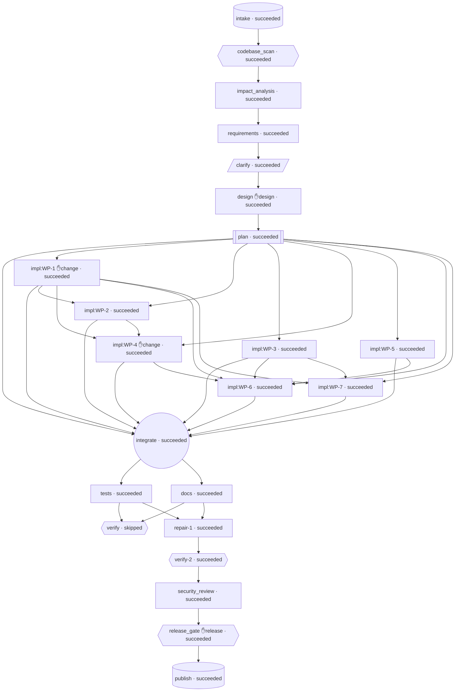

# Engineering Summary — ambiguous (run_9f7e81be929b)

**Status:** succeeded  
**Requirement:** Marketing is launching a big campaign next week and will put our short links on billboards and
in a TV ad. Make the link service faster and more trustworthy before then.

## 1. Requirement understanding
Next week marketing starts a billboard and TV campaign that will show our short links to the public. The product owner has set the targets (Q-1): peak load is modest, up to about 50 redirect requests per second. Redirect p95 latency must be under 100 ms. Availability is best effort on one instance. Production stays on SQLite, hardened with WAL, a busy_timeout and a configurable pool (Q-2). No new database driver is added. The move to PostgreSQL for multi-worker or larger scale is documented but not implemented.

Amendment amd_5305a8421c78 adds two product needs:
(a) Campaign links must stop working on their own when the campaign ends (31 December, 23:59 UTC), with no one deactivating links by hand.
(b) Marketing must be able to see how many clicks each link got in each hour during the TV ad slots.

The current service has these defects or gaps for campaign traffic:
(1) SQLite has no hardening: no WAL, the default busy timeout and no pool configuration. Redirect lookups block behind click and create commits, and the runbook describes this behaviour wrongly.
(2) Pool sizing cannot be configured.
(3) HEAD /healthz and HEAD /readyz fall through to the catch-all HEAD /{code} route and return 404, so HEAD-based uptime monitors would report an outage.
(4) Stats load one row per click, so memory and time grow without limit.
(5) Links cannot expire. Redirect resolution checks only is_active.
(6) Analytics are bucketed only by UTC day, so clicks during an ad slot cannot be measured.
(7) There is no migration tooling. create_all never alters existing tables, so adding a column without an upgrade step would make every redirect against the production database return 503.
(8) On MySQL, codes match case-insensitively. This is low priority because production is SQLite.
(9) The docs contradict the code on authentication.

This change does the following:
- Makes the redirect path fast and resistant to contention on one SQLite instance.
- Makes DB tuning configurable.
- Adds a per-link expires_at that is enforced on GET and HEAD, can be set at creation or on existing links, and is applied to deployed databases by an idempotent startup schema upgrade.
- Adds a bounded, API-key-protected hourly click endpoint.
- Makes the probes and analytics trustworthy.
- Corrects the docs and adds a campaign runbook.

Every existing contract must stay intact: a 307 with the exact Location header and no-store; an immediate 410 after deactivation; synchronous click counting; privacy; the unchanged daily stats contract; idempotency replays of keys stored before the deploy; and the architecture rules. The deadline is one week, so the scope favours small, low-risk changes. That means no caching, no asynchronous ingestion, no new drivers, and only one additive, nullable schema change. New ids continue from FR-1..FR-21 and NFR-1..NFR-20.

**Clarifications obtained from a human:**
- Q-1: What are the measurable campaign targets: expected peak redirect requests per second or concurrent visitors, the redirect latency target (p95/p99), and the availability goal during the campaign window? → **Modest: up to about 50 RPS, p95 < 100 ms, best effort (one instance is enough)** (human:kajalmahata)
- Q-2: Which database and topology will serve the campaign in production: SQLite on one instance, or PostgreSQL/MySQL with several workers or replicas? If PostgreSQL, should we pin a driver (e.g. psycopg) in requirements.txt? → **Keep the current SQLite backend and harden it (WAL, busy_timeout, configurable pool). Add no new driver. Document the move to PostgreSQL for multi-worker or campaign scale.** (human:kajalmahata)

**Amendments applied mid-run (triggered re-planning):**
- Update from marketing: campaign links must stop working automatically when the campaign ends (31 December, 23:59 UTC), and we need to see how many clicks each link got per hour during the TV ad slots. (product-owner)

| ID | Requirement | Priority | Verified by tests |
|---|---|---|---|
| FR-14 | HEAD support on liveness and readiness probes | must | ✅ |
| FR-15 | Redirects resilient to database write contention (hardened SQLite) | must | ✅ |
| FR-16 | Configurable database connection pool | must | ✅ |
| FR-17 | Lean redirect query budget | should | — |
| FR-18 | Bounded-memory daily stats aggregation | must | ✅ |
| FR-19 | Case-sensitive short-code matching on MySQL | could | — |
| FR-20 | Accurate documentation, campaign runbook and changelog | must | ✅ |
| FR-21 | Regression protection of existing contracts | must | ✅ |
| FR-22 | Automatic link expiry enforced on redirect | must | ✅ |
| FR-23 | Set expiry on link creation and expose it in responses | must | ✅ |
| FR-24 | Set, change or clear expiry on existing links | must | ✅ |
| FR-25 | Hourly click counts per link | must | ✅ |
| FR-26 | Idempotent startup schema upgrade for links.expires_at | must | ✅ |

- **NFR-10** (performance): Campaign target (Q-1): at a sustained ~50 requests per second of mixed traffic on one app instance with a temp file SQLite database (WAL, default settings), redirect p95 < 100 ms with zero 5xx. The mix is 95% GET /{code} over 1,000 seeded links, some of them with a future expires_at, and 5% POST /api/links. The click count equals the successful GETs minus any logged best-effort failures (expected 0). — _tests/test_perf_concurrency.py, marked slow. It runs an open-loop paced generator at 50 RPS for 20 s using a ThreadPoolExecutor (≤16 workers) and TestClient, and asserts the status distribution, the client-side p95 and the click count._
- **NFR-11** (performance): The existing single-threaded budget (NFR-4) must not regress after the expiry check and the WAL configuration are added: redirect p95 < 50 ms and create p95 < 100 ms on 10k seeded links. — _The existing test_performance_p95_redirect_and_create passes with its thresholds unchanged._
- **NFR-12** (reliability): A failure or lock timeout during click recording never turns a resolvable redirect into a non-307 response. While a lock is held, the worst-case added latency is SQLITE_BUSY_TIMEOUT_MS + 500 ms. — _The FR-15 lock tests, plus a fault-injection test that makes the click INSERT or COMMIT raise OperationalError and asserts a 307, a rollback, and a log line without the IP._
- **NFR-13** (scalability): Daily stats memory is O(days + referrer groups), and hourly stats memory is O(hours in range), never O(clicks). — _The FR-18 tracemalloc comparison (200k vs 2k clicks, peak at most 2×), the repository return-shape tests, and the NFR-21 hourly memory test._
- **NFR-14** (privacy): NFR-1 is preserved. No raw IP is stored or logged anywhere, including the click-failure warnings, the startup tuning and schema-upgrade logs, and the expiry and hourly paths. ip_hash stays HMAC-SHA256 and is set only when IP_HASH_SALT is configured. The hourly endpoint returns only aggregate counts, with no per-click data. — _The existing privacy tests, plus caplog tests on the click-failure, lock, expired-redirect and hourly paths asserting that the client IP and the X-Forwarded-For values are absent, plus a response-shape test for the hourly endpoint._
- **NFR-15** (security): No security regressions:
- /healthz never touches the DB.
- Errors leak no exception text.
- Cache-Control: no-store stays on redirects, including 410 responses for expired links, so expiry takes effect at once for repeat visitors.
- The API-key check stays constant-time and fails closed, and covers the new PATCH and hourly routes.
- No secrets appear in logs. — _The existing auth, health and error tests; new auth tests for PATCH and hourly; static checks for eval/exec/subprocess and for text() used only with literals; and a caplog test that the startup log contains neither the DATABASE_URL password nor API_KEY._
- **NFR-16** (operability): At startup the app logs one structured line with the effective DB tuning: dialect, pool size, overflow and timeout, and for SQLite the journal_mode, synchronous and busy_timeout. It logs one line with the schema-upgrade outcome. Neither line contains credentials. — _A caplog test on create_app with a TestClient lifespan asserts that the fields are present and the secrets absent._
- **NFR-17** (maintainability): The architecture and static rules hold:
- Layering points inward.
- Services import no FastAPI or Starlette.
- Core imports nothing from api, services or repositories.
- Schemas import nothing from app.
- There are no lru_cache/cache names.
- New settings are validated in app/core/config.py.
- requirements.txt stays pinned with == and gains no new runtime dependency (Q-2).

Coverage stays at or above 99%, and every new test docstring names the FR/NFR ids it covers. — _The existing AST and static architecture tests pass, pytest --cov reports at least 99%, and a test or review confirms requirements.txt has no new entries._
- **NFR-18** (reliability): The only change to existing tables is the additive, nullable links.expires_at column, applied automatically and idempotently at startup (FR-26). The MySQL-only collation declaration (FR-19) affects only fresh MySQL databases. The deployed SQLite database keeps working with no manual step, and existing rows and behaviour are unchanged. — _A test compiles CreateTable for SQLite and PostgreSQL and compares it with a baseline snapshot, with only the expires_at column added. A second test starts the app against a SQLite file created by the previous version (old schema, rollback-journal mode) and confirms the switch to WAL, the column being added, and working redirects, stats and idempotency replays._
- **NFR-19** (performance): Burst headroom for TV-ad spikes: 16 unpaced concurrent client threads send 2,000 requests in the 95/5 mix against a WAL temp file database. There must be zero 5xx and redirect p95 < 250 ms in CI. Clicks may be dropped only through logged best-effort failures. — _A second case in tests/test_perf_concurrency.py, marked slow, asserting no 5xx, the p95 bound, and that clicks plus logged failures equal the successful GETs._
- **NFR-20** (operability): Before launch, operators can verify the campaign set-up on the real deployment without new tooling. The checklist covers: the startup tuning and schema-upgrade log lines; HEAD /healthz and HEAD /readyz returning 200; a recent backup; expires_at set to the confirmed campaign end on every campaign link (checked with GET /api/links/{code}); an hourly stats query returning data for a test link; and a ~50 RPS smoke load showing p95 < 100 ms. — _Reviewers confirm the checklist in the 'Campaign deployment' section of docs/OPERATIONS.md. A doc test checks that the section exists and mentions the HEAD probes, the targets, expires_at and the hourly endpoint._
- **NFR-21** (performance): The hourly stats endpoint is fast and bounded for campaign-scale links. With 200,000 clicks on one link, all within a 744-hour range, the request returns 200 in under 2 s, and memory does not grow with the click count. — _A slow test in tests/test_hourly_stats.py seeds 200k and 2k clicks and asserts the latency bound and a tracemalloc peak at most 2× the 2k case. The query uses the existing (link_id, created_at) index with a half-open range, checked with EXPLAIN QUERY PLAN on SQLite._
- **NFR-22** (reliability): Time handling is exact and timezone-safe. Expiry and hourly bucketing use naive UTC throughout. Aware inputs with any offset are converted, and naive inputs are treated as UTC. No comparison between naive and aware values can raise (no 500). Expiry takes effect at the exact stored instant, to the precision of the stored value, on every request. — _Tests with offsets +01:00, -05:00 and +05:30 on create, PATCH and the hourly parameters, plus boundary tests using an injected clock (1 µs before the instant, exactly at it, and after it). None of them returns a 500._

## 2. Codebase reasoning (brownfield)
Brownfield change to a layered FastAPI/SQLAlchemy URL shortener (165 tests pass, 99% coverage). The brief and amendment amd_5305a8421c78 add three things: (1) make the service faster and more reliable for a modest campaign (Q-1: about 50 RPS, redirect p95 under 100 ms, one instance) by hardening SQLite (Q-2: WAL, busy_timeout, configurable pool, no new driver, document the move to PostgreSQL); (2) links that stop working automatically at a set time (campaign end 31 Dec 23:59 UTC), so a new nullable `links.expires_at` column, a check in GET/HEAD /{code} on the redirect path, and new fields in the create and detail APIs; (3) clicks per hour per link for the TV ad slots, so a new hourly aggregation in StatsService/ClickRepository and a new endpoint. The biggest risk is the database schema: `Base.metadata.create_all` never alters existing tables, so adding `expires_at` to `Link` would make every query on `links` fail against the existing production `shortener.db`. That means 503 on every redirect unless an idempotent startup migration (or a documented manual ALTER) ships with the change. Today `create_db_engine` applies no SQLite tuning (no WAL, no explicit busy timeout, no pool settings). The docs (README, docs/API.md, docs/OPERATIONS.md, CHANGELOG) are out of date: they say there is no authentication, but `require_api_key` is in place.

**Impacted files:**
- `app/core/db.py` (modify): Harden SQLite. Add a 'connect' event listener that sets PRAGMA journal_mode=WAL, synchronous=NORMAL and (optionally) foreign_keys=ON, using literal SQL only. Set the busy timeout through connect_args={'timeout': seconds}, the sqlite3 driver's busy handler, so no PRAGMA string has to be built with formatting. Apply pool settings (pool_size, max_overflow, pool_timeout) only to file-based SQLite and to other backends: in-memory 'sqlite://' uses SingletonThreadPool/StaticPool, which rejects max_overflow/pool_timeout (test_main_exposes_create_app_and_module_app uses 'sqlite://'). Add an idempotent schema upgrade helper that adds links.expires_at when the column is missing (inspect plus a literal ALTER TABLE ... ADD COLUMN).
- `app/core/config.py` (modify): New validated settings, for example DB_POOL_SIZE, DB_MAX_OVERFLOW, DB_POOL_TIMEOUT, SQLITE_BUSY_TIMEOUT_MS (or seconds), SQLITE_WAL (bool), and possibly HOURLY_STATS_MAX_HOURS. Defaults must keep test_settings_defaults_and_env passing.
- `app/main.py` (modify): Pass the new pool and SQLite settings to create_db_engine. In the lifespan, run the idempotent schema upgrade (add expires_at) after create_all. Update the docstring.
- `app/models/link.py` (modify): Add `expires_at: Mapped[datetime | None] = mapped_column(DateTime, nullable=True)` (naive UTC, portable sqltypes only, as test_orm_uses_declarative_base_and_portable_types requires). Consider an index if expiry queries or sweeps are added.
- `app/services/link_service.py` (modify): Add an expiry check (now >= expires_at means expired) to resolve_for_redirect and resolve_and_record_click (raise GoneError with a distinct detail such as 'Link has expired', and record no click). Accept an optional expires_at in create_link: it must be in the future, tz-aware input is converted to naive UTC, and it is included in the idempotency request_hash. Optionally add set_expiry for existing links. Inject a clock (a `now` callable or parameter) for deterministic tests. Optionally end the read transaction before inserting the click to avoid SQLite read-to-write lock upgrade failures (SQLITE_BUSY_SNAPSHOT in WAL).
- `app/services/stats_service.py` (modify): Add get_hourly_clicks(code, start, end, now=None): validate the range (start < end, capped length), bucket timestamps by UTC hour in Python as the daily stats do, and return buckets sorted ascending (only hours with clicks, or zero-filled; decide and document). Works for deactivated and expired links.
- `app/repositories/click_repository.py` (modify): Add created_at_between(link_id, start, end) for half-open [start, end) ranges, served by ix_click_events_link_id_created_at.
- `app/repositories/link_repository.py` (modify): Optional: a helper to update expiry, or a bulk set-expiry by code list if the PO wants a campaign-wide expiry on existing links.
- `app/schemas/links.py` (modify): LinkCreate: optional `expires_at: datetime | None` (must be in the future; naive values treated as UTC). LinkCreatedResponse/LinkDetailResponse: add expires_at (serialised through _as_utc) and possibly is_expired. New HourlyClicks{hour: datetime (UTC, top of hour), count} and LinkHourlyStatsResponse. Optionally a LinkUpdate schema (PATCH expires_at). Keep LinkStatsResponse unchanged, because test_stats_shape_and_empty_link compares it exactly.
- `app/schemas/__init__.py` (modify): Export the new schema classes.
- `app/api/links.py` (modify): Pass expires_at through on create and return it on create and detail. New GET /api/links/{code}/stats/hourly?start=&end= (API key required, 422 on an invalid or oversized range). Optionally PATCH /api/links/{code} to set or clear expires_at on links that already exist. Update the OpenAPI responses (410 'Link has expired' on redirect).
- `app/api/redirect.py` (modify): Document the 410 for expired links in the responses metadata. The behaviour comes from the service. HEAD must behave the same as GET.
- `tests/test_expiry.py` (add): Expiry tests: redirect works before expires_at; GET and HEAD return 410 at or after it, with no click recorded; validation on create (expiry in the past gives 422); tz conversion; idempotency with a different expires_at gives 409; schema upgrade on a database created without the column.
- `tests/test_hourly_stats.py` (add): Hourly bucketing across hour and UTC-day boundaries, range validation (422), deactivated and expired links still report, counts only for the requested link, fixed `now`.
- `tests/test_db_hardening.py` (add): Asserts PRAGMA journal_mode returns 'wal' on a file database, the busy timeout is applied, pool settings come from config, in-memory URLs still work, and concurrent redirects and creates on one file database lose no clicks and return no 503.
- `tests/test_config_openapi_architecture.py` (modify): Extend the settings defaults/env tests for the new settings and the OpenAPI checks for the new endpoint and schemas. The perf test may be aligned with the p95 < 100 ms target or kept stricter.
- `README.md` (modify): Add the new settings to the configuration table, plus expiry, hourly stats and the SQLite/WAL notes. Fix the stale 'no authentication' notice and add API_KEY to the configuration table.
- `docs/API.md` (modify): Document expires_at on create and detail, the 410 'Link has expired', the hourly stats endpoint and optional PATCH. Fix 'Authentication: none'.
- `docs/OPERATIONS.md` (modify): Cover the WAL files (-wal/-shm, backups), busy_timeout and pool tuning, the schema upgrade step, the campaign runbook (setting expiry, querying hourly stats), and the move to PostgreSQL for multi-worker or larger scale. Fix the stale 'No authentication (known gap)' security note.
- `CHANGELOG.md` (modify): Add an Unreleased entry for the features, the schema change and the hardening. Correct the security notes (API key auth exists).

**Data flows touched:**
- Redirect hot path: GET /{code} -> RequestLoggingMiddleware -> redirect.redirect -> deps.get_link_service -> core.db.get_db (session from the engine pool, now WAL plus busy timeout) -> LinkService.resolve_and_record_click -> LinkRepository.get_by_code (indexed on code) -> [new] is_active and expires_at check against utcnow -> ClickRepository.add + commit (best-effort) -> raw 307 with Location and no-store
- HEAD /{code} -> LinkService.resolve_for_redirect -> get_by_code -> [new] expiry check -> 307/404/410
- Create: POST /api/links -> require_api_key -> LinkCreate validation ([new] expires_at in the future, converted to naive UTC) -> LinkService.create_link (request_hash now covers url and expires_at) -> LinkRepository.add / IdempotencyRepository.add -> commit -> LinkCreatedResponse (with expires_at)
- Detail: GET /api/links/{code} -> LinkService.get_link_detail -> LinkDetailResponse (with expires_at)
- Hourly stats (new): GET /api/links/{code}/stats/hourly -> require_api_key -> StatsService.get_hourly_clicks -> LinkRepository.get_by_code -> ClickRepository.created_at_between (index link_id, created_at) -> Python bucketing by UTC hour -> LinkHourlyStatsResponse
- Startup: create_app -> create_db_engine (pool and SQLite pragmas via connect listener) -> lifespan: create_all -> [new] idempotent ALTER TABLE links ADD COLUMN expires_at if missing

**Existing defects found:**
- The SQLite engine has no hardening: default rollback journal (no WAL), no explicit busy timeout, and SQLAlchemy's default pool size with no configuration. Concurrent creates and click inserts can hit 'database is locked', which OPERATIONS.md itself admits (sporadic 503s, lost clicks). @ app/core/db.py:create_db_engine
- Links cannot expire: there is no expiry field and redirect resolution only checks is_active, so campaign links would keep redirecting after the campaign ends unless someone deletes each one by hand. @ app/models/link.py; app/services/link_service.py:resolve_for_redirect and resolve_and_record_click
- No hourly analytics: stats only bucket by UTC day, so clicks during a TV ad slot cannot be measured. @ app/services/stats_service.py:get_stats; app/schemas/links.py:LinkStatsResponse
- Schema changes are never applied to existing databases: create_all only creates missing tables, and there is no migration tooling. Any model column addition breaks existing deployments. @ app/main.py:create_app lifespan
- The redirect read-then-write runs in one deferred SQLite transaction. Under concurrent writers this lock upgrade can fail (SQLITE_BUSY), and the failure is swallowed as a lost click, which makes click counts less reliable during spikes. @ app/services/link_service.py:resolve_and_record_click
- The docs say there is no authentication, but the management API requires an X-API-Key (fail closed). The README configuration table also leaves out API_KEY. This misleads operators preparing the campaign. @ README.md (Security notice, Configuration table); docs/API.md ('Authentication: none in this release'); docs/OPERATIONS.md (Security notes 'No authentication (known gap)'); CHANGELOG.md ([1.0.0] Security)
- Foreign keys are not enforced on SQLite: click_events.link_id has a ForeignKey, but PRAGMA foreign_keys is never turned on, so orphan click rows are possible. @ app/core/db.py; app/models/click_event.py
- LinkService has no injectable clock (it calls utcnow() directly), so time-dependent rules such as expiry cannot be tested deterministically without monkeypatching. @ app/services/link_service.py (deactivate uses utcnow())

## 3. Plan & decomposition
Waves (parallel groups): [['WP-1', 'WP-3', 'WP-5'], ['WP-2', 'WP-7'], ['WP-4'], ['WP-6']]

- **WP-1 Foundation: settings, engine hardening, schema upgrade, errors, logging fields, model column** → app/core/config.py, app/core/db.py, app/core/schema.py, app/core/errors.py, app/core/logging.py, app/models/base.py, app/models/link.py, app/models/__init__.py (deps: —; succeeded, 2 attempt(s))
- **WP-2 Repositories: narrow redirect lookup and SQL day/hour aggregation** → app/repositories/link_repository.py, app/repositories/click_repository.py, app/repositories/__init__.py (deps: ['WP-1']; succeeded, 1 attempt(s))
- **WP-3 Schemas: expiry fields, PATCH body, hourly response** → app/schemas/links.py, app/schemas/__init__.py (deps: —; succeeded, 1 attempt(s))
- **WP-4 Services: expiry rule, clock, best-effort clicks, create/PATCH expiry, SQL daily stats, hourly stats** → app/services/link_service.py, app/services/stats_service.py (deps: ['WP-1', 'WP-2']; succeeded, 1 attempt(s))
- **WP-5 Health router: HEAD probes** → app/api/health.py (deps: —; succeeded, 1 attempt(s))
- **WP-6 Links and redirect routers, app wiring** → app/api/links.py, app/api/redirect.py, app/main.py (deps: ['WP-1', 'WP-3', 'WP-4', 'WP-5']; succeeded, 1 attempt(s))
- **WP-7 Documentation: README, API reference, operations runbook, changelog** → README.md, docs/API.md, docs/OPERATIONS.md, CHANGELOG.md (deps: ['WP-1', 'WP-3']; succeeded, 1 attempt(s))

## 4. Architecture decisions
- **ADR-1 Harden SQLite with a connect listener, connect_args timeout and QueuePool settings** — For file-based SQLite:
- create_engine(url, poolclass=QueuePool, pool_size, max_overflow, pool_timeout, connect_args={'check_same_thread': False, 'timeout': (SQLITE_BUSY_TIMEOUT_MS + 0.5) / 1000.0}).
- An event.listens_for(engine, 'connect') handler executes the literal statements 'PRAGMA journal_mode=WAL' and 'PRAGMA synchronous=NORMAL' on a raw DBAPI cursor.
- The +0.5 ms makes pysqlite's int(timeout*1000) truncation land exactly on the configured value.

In-memory SQLite gets only check_same_thread=False. Non-SQLite gets pool_pre_ping=True plus the pool settings.. _Why:_ WAL lets readers proceed while a writer holds the lock, which is what stops redirects queueing behind creates and clicks. The sqlite3 timeout parameter installs the busy handler without building a PRAGMA string, so the literal-only SQL policy holds. QueuePool kwargs are not valid for SingletonThreadPool/StaticPool, so in-memory URLs skip them. _Alternatives:_ PRAGMA busy_timeout=<n> built with formatting (violates policy), Move to PostgreSQL now (rejected by Q-2; needs a driver), Leave the rollback journal and only add a busy timeout (readers would still block)
- **ADR-2 Idempotent startup ALTER instead of migration tooling** — After create_all, the lifespan calls app.core.schema.ensure_links_expires_at(engine):
- It uses sqlalchemy.inspect on a fresh connection.
- If 'expires_at' is not among the links columns, it runs the dialect-guarded literal ALTER inside engine.begin().
- It logs 'added' or 'already_present'.
- On any exception it logs an ERROR and re-raises, so startup aborts.. _Why:_ There is one additive, nullable column and a one-week deadline. Alembic would add a dependency, a workflow and operator steps. Without the upgrade, every redirect on the deployed DB would return 503. Failing startup loudly is better than serving 503s. _Alternatives:_ Alembic migrations (out of scope), Documented manual ALTER only (operator error risk RK-11), A separate link_expiry table (more joins on the hot path)
- **ADR-3 Expiry evaluated in Python on the narrow lookup row, with an injectable clock** — LinkRepository.get_redirect_target selects only id, url, is_active and expires_at. LinkService._check_redirectable(target) raises GoneError() if the link is inactive, then GoneError(LINK_EXPIRED_DETAIL) if expires_at is not None and self._utcnow() >= expires_at. GET and HEAD both go through _resolve_target, which calls _check_redirectable. The clock is LinkService(now=callable|None); _utcnow() calls it, falling back to models.utcnow(), and normalises to naive UTC.. _Why:_ This adds no SQL statements (FR-17). The rule is evaluated on every request with no cache (FR-22), and both methods share one helper (RK-14). Deactivation takes precedence. Tests are deterministic. _Alternatives:_ WHERE expires_at > :now in SQL (cannot distinguish 404, 410-deactivated and 410-expired without a second query), In-process cache of links (forbidden; breaks immediate deactivation and expiry)
- **ADR-4 Backward-compatible idempotency hash** — request_hash = sha256(url) when expires_at is None; otherwise sha256(url + '\n' + canonical UTC instant 'YYYY-MM-DDTHH:MM:SS.ffffffZ'). The replay check runs before the future-instant check.. _Why:_ Keys stored before the deploy (url-only hashes) keep replaying. The same instant written with different offsets hashes identically. Adding or changing expires_at gives 409. Replays return the stored link even after the expiry has passed, which matches how deactivated links replay. _Alternatives:_ Always hash a JSON payload (breaks old keys, RK-15), Ignore expires_at in the hash (silent replay of a different payload)
- **ADR-5 SQL aggregation with dialect-guarded bucket expressions that use no bound parameters** — Daily and hourly stats use SELECT bucket, COUNT(id) ... WHERE link_id = :id AND created_at >= :start [AND created_at < :end] GROUP BY bucket.

Day bucket:
- sqlite: func.date(created_at)
- postgresql (and the fallback): cast(created_at, Date)
- mysql/mariadb: func.date(created_at)

Hour bucket:
- sqlite: func.strftime(literal_column("'%Y-%m-%d %H:00:00'"), created_at)
- postgresql (and the fallback): func.date_trunc(literal_column("'hour'"), created_at)
- mysql/mariadb: func.timestampadd(literal_column('HOUR'), func.hour(created_at), func.date(created_at))

Result values are normalised in Python (str -> date/datetime). Module-level statement builders take dialect_name so tests can compile them for all three dialects.. _Why:_ Memory is O(days) or O(hours) and the query uses the covering (link_id, created_at) index. With no bind parameters inside the bucket expression, the GROUP BY matches the SELECT expression on PostgreSQL. String formats are constants, not SQL formatting. _Alternatives:_ Stream timestamps with yield_per and bucket in Python (portable but O(clicks) time), Denormalised hourly counter table (new schema, out of scope)
- **ADR-6 Explicit HEAD routes for the probes** — health.py adds @router.head('/healthz', include_in_schema=False) and @router.head('/readyz', include_in_schema=False). They return Response(status_code=200) with an empty body. /readyz shares a private _check_database(db) helper with GET.. _Why:_ This guarantees an empty body and leaves the OpenAPI path and operation set untouched. The health router is included before the catch-all, so HEAD /{code} never sees these paths. POST still yields 405. _Alternatives:_ api_route(methods=['GET','HEAD']) (adds 'head' operations to the OpenAPI schema and relies on the server to strip the body)
- **ADR-7 End the read transaction before the click insert; best-effort WARNING on failure** — In resolve_and_record_click, after the lookup and checks, call self.session.rollback(). This ends the read transaction and is a transaction-boundary call, not a statement. Then call ClickRepository.add(...) and session.commit() inside try/except Exception. On failure:
- Roll back, suppressing any secondary exception.
- Log exactly one logger.warning('failed to record click for link_id=%s (%s)', link_id, type(exc).__name__), with no IP, no exception message and no traceback.
- Return the URL.. _Why:_ This avoids SQLITE_BUSY_SNAPSHOT on the read-to-write upgrade under WAL and bounds the added latency to the busy timeout. The exception message can contain bound SQL parameters, so it is not logged. ClickRepository.add remains the patch point used by existing tests. _Alternatives:_ session.commit() after the read (shows up as a second COMMIT in the query budget), BEGIN IMMEDIATE for the whole redirect (serialises reads behind writers), Asynchronous click ingestion (out of scope, Q-5)
- **ADR-8 Future-instant validation in the service with a 422 domain error** — Add InvalidInputError(AppError) with status 422 in app/core/errors.py. Schemas only parse and normalise (to naive UTC, non-string values rejected). LinkService raises InvalidInputError('expires_at must be in the future') using its injectable clock. StatsService raises InvalidInputError for invalid hourly ranges.. _Why:_ Validation that depends on the clock must use the injectable clock and must be skipped on idempotent replay. A Pydantic validator cannot do either. The error body stays {"detail": "..."}. _Alternatives:_ Pydantic validator calling datetime.now() (cannot be tested deterministically; would break replay), Raise HTTPException from the services (violates layering)
- **ADR-9 No-store on redirect-path error responses** — redirect.py catches NotFoundError and GoneError from the service and returns JSONResponse({'detail': exc.detail}, status_code=exc.status_code, headers={'Cache-Control': 'no-store'}). Other exceptions propagate to the global handlers (SQLAlchemyError -> 503).. _Why:_ Browsers and CDNs could otherwise cache a 410 or 404 after a link is created, cleared or extended. Expiry and PATCH changes take effect immediately (NFR-15). _Alternatives:_ Add no-store to every AppError in the global handler (wider blast radius)
- **ADR-10 MySQL case-sensitive codes via a type variant** — Declare code as String(32).with_variant(String(32, collation='utf8mb4_bin'), 'mysql', 'mariadb'). Document the manual DDL for existing MySQL databases: ALTER TABLE links MODIFY code VARCHAR(32) CHARACTER SET utf8mb4 COLLATE utf8mb4_bin NOT NULL;. _Why:_ This keeps portable sqltypes (type(col.type) is still sqltypes.String) and leaves the SQLite and PostgreSQL DDL unchanged. _Alternatives:_ A global collation (breaks SQLite), Dialect-specific types from sqlalchemy.dialects (forbidden in models)

**API contract:**
- `POST /api/links` — Create a short link. Requires X-API-Key. Optional Idempotency-Key header and optional expires_at.
- `GET /api/links/{code}` — Get link metadata, including deactivated and expired links. Requires X-API-Key.
- `PATCH /api/links/{code}` — Set, change or clear the expiry of an existing link. Requires X-API-Key.
- `DELETE /api/links/{code}` — Deactivate (soft-delete) a link. Idempotent. Requires X-API-Key. Unchanged.
- `GET /api/links/{code}/stats` — Daily click stats. Contract unchanged; now aggregated in SQL. Requires X-API-Key.
- `GET /api/links/{code}/stats/hourly` — Clicks per UTC hour for one link over [start, end), zero-filled. Requires X-API-Key.
- `GET /{code}` — Public redirect. Records exactly one click on success (best-effort). The HEAD /{code} twin (not in the schema) returns the same status and headers and records no click.
- `GET /healthz` — Liveness probe; never touches the DB. HEAD /healthz (not in the schema) returns 200 with an empty body. POST returns 405.
- `GET /readyz` — Readiness probe (SELECT 1). HEAD /readyz (not in the schema) returns 200 with an empty body, or 503. POST returns 405.

## 5. Validation
- ✅ **compile** — ok
- ✅ **lint_correctness** — All checks passed!
- ✅ **tests_pass** — 404 passed, 0 failed, 0 errors
- ✅ **coverage** — 99.78% (minimum 80.0%)
- ✅ **api_contract** — 9 contract endpoints implemented
- ✅ **requirements_traceability** — 11 must-FRs traced
- ✅ **policy_scan_full_tree** — 1 non-blocking findings

**Security review:**
- [medium] No built-in rate limiting: each unauthenticated GET /{code} writes a row (DB growth, write-lock contention, inflated campaign stats), and the campaign pre-launch checklist does not require gateway rate limits @ app/api/redirect.py:61-75 (redirect -> LinkService.resolve_and_record_click, app/services/link_service.py:280-312); docs/OPERATIONS.md:599 and :761 (Pre-launch checklist) → Before the campaign, enforce per-client rate limits at the reverse proxy or gateway:
- On the public redirect (e.g. a per-IP burst limit that still allows legitimate TV-spike traffic).
- On repeated 401s on /api/links*.
- A request body size limit (e.g. 16 KB) for /api/links.
Add an explicit 'gateway rate limiting and body-size limit configured and tested' item to the Campaign deployment pre-launch checklist. Without it, one client can insert clicks of up to ~2.5 KB each (referrer plus user agent) without limit. That fills the local disk, takes the single SQLite write lock so legitimate clicks are dropped, and skews the per-slot hourly numbers. Optionally, add a cheap in-app guard later (e.g. skip recording clicks while the per-process insert rate exceeds a threshold).
- [medium] Personal data minimisation: full Referer URLs (including query strings) and raw User-Agent strings are stored indefinitely with no retention mechanism @ app/services/link_service.py:299-300; app/models/click_event.py (referrer String(2048), user_agent String(512)); docs/OPERATIONS.md:498-524 (Retention: nothing ever deleted) → Store only what the stats use:
- Reduce the referrer to its origin (scheme://host) before storing it. top_referrers works at origin granularity, and query strings often carry emails, session or campaign tokens.
- Either drop user_agent or reduce it to a coarse family/class, since nothing in the API reads it.

Add a documented, scheduled retention purge for click_events (e.g. 90-180 days, configurable), and record the legal basis in the DPIA. Combined with a stable ip_hash, the current raw UA plus full referrer kept forever makes clicks linkable to individuals. For IP_HASH_SALT, document periodic rotation to limit long-term linkability.
- [low] The database error handler logs full SQLAlchemy exceptions, whose text includes bound parameters (target URL, idempotency key, codes) @ app/core/errors.py:86 (_sqlalchemy_error_handler logger.exception); app/core/db.py:62/67/92 (create_engine calls) → Pass hide_parameters=True to all three create_engine calls in create_db_engine. SQLAlchemy then omits '[parameters: ...]' from exception messages and the logged tracebacks. This keeps the server-side 'database error' log consistent with the documented promise that request bodies are never logged. The design already took this approach for the click-failure WARNING.
- [low] IP_HASH_SALT (and DATABASE_URL, which may carry credentials) are plain str settings, so they appear in repr() and any accidental Settings dump @ app/core/config.py:24 (database_url), app/core/config.py:28 (ip_hash_salt) → Declare ip_hash_salt as SecretStr | None and read it with get_secret_value() in get_link_service (app/api/deps.py), the same way api_key is handled. Consider SecretStr for database_url too, or at least make sure Settings is never logged. Anyone holding the salt can brute-force IPv4 addresses from ip_hash, so it deserves the same treatment as the API key.
- [low] Interactive API docs and the OpenAPI schema are public, and responses lack basic hardening headers @ app/main.py:70 (FastAPI(...) with default docs_url, redoc_url and openapi_url) → Either disable /docs, /redoc and /openapi.json in production through a setting (e.g. docs_url=None, openapi_url=None unless an ENABLE_DOCS flag is set), or restrict them at the proxy. At the proxy, add X-Content-Type-Options: nosniff and Strict-Transport-Security. The OpenAPI schema lists every management endpoint and the API-key header name, which makes probing easier for attackers. Also bind uvicorn to 127.0.0.1 or a private interface behind the TLS proxy, rather than 0.0.0.0 as in the runbook examples.
- [low] Runtime requirements include test tooling, and transitive dependencies (starlette, h11, anyio, pydantic-core) are not locked @ requirements.txt:6-8 (httpx, pytest, pytest-cov) → Split dependencies into requirements.txt (runtime) and requirements-dev.txt (pytest, pytest-cov, httpx), so production images do not ship test tooling. Add a hash-locked constraints file (e.g. pip-compile --generate-hashes) that pins the transitive packages. Make sure h11 >= 0.16.0 is installed (CVE-2025-43859, request smuggling in uvicorn's h11 backend). Track the starlette range that fastapi 0.115.6 allows (<0.42): the known multipart and FileResponse CVEs do not affect this app, which uses neither, but plan a FastAPI upgrade.

## 6. Risks & trade-offs
- TV ad spikes may briefly exceed ~50 RPS. SQLite is single-writer, so latency can rise or clicks can be dropped, and dropped clicks make the hourly analytics less accurate. — _mitigation:_ Best-effort click writes with a bounded busy_timeout (FR-15, NFR-12); the burst test (NFR-19); logging of dropped clicks without the IP so drops can be counted per hour; a recommended timeout of 1000 ms; and the documented PostgreSQL path.
- WAL changes the on-disk files and the backup procedure, fails on network filesystems, and does not apply to in-memory databases. — _mitigation:_ Apply WAL only to file-based SQLite; add pragma tests and an upgrade test (NFR-18); update the backup and runbook docs (FR-20).
- Moving the daily or hourly stats to SQL aggregation could change bucketing or window edges across dialects. — _mitigation:_ Use the existing stats tests, unmodified, as the oracle; add explicit hourly boundary tests; compile per dialect; allow streaming with Python bucketing as a fallback.
- Changing the probe routing could disturb the catch-all order, the OpenAPI paths or the 405 behaviour. — _mitigation:_ Use api_route(methods=['GET','HEAD']) on the probes and keep the redirect router last; assert the behaviour listed in FR-14.
- Short busy timeouts drop clicks under contention. — _mitigation:_ Make the timeout configurable (Q-7), log each drop, and document the trade-off.
- The load tests may be flaky on slow CI runners. — _mitigation:_ Mark them slow, use a paced generator, treat zero 5xx as the primary assertion, and keep the burst threshold generous.
- The MySQL collation fix does not reach existing deployments without the manual DDL. — _mitigation:_ Production is SQLite. Document the DDL.
- The one-week deadline leaves little time for review and a staged rollout. The scope has grown with expiry, PATCH, hourly stats and the migration. — _mitigation:_ Priority order:
1. FR-26 and FR-22/23/24 (the campaign end is a hard business requirement), then FR-15/16, FR-25, FR-14, FR-21 and FR-20.
2. FR-18 and FR-17.
3. FR-19.

Keep defaults that preserve current behaviour, and run the NFR-20 checklist on the production host.
- Best effort on one instance means a host failure is a full outage, and data loss is possible without backups. — _mitigation:_ Accepted per Q-1. Document the supervisor restart, HEAD /readyz monitoring, WAL-safe backups and recovery.
- Operators may run several uvicorn workers on SQLite. — _mitigation:_ The campaign section states one worker, the startup log makes the configuration visible, and the PostgreSQL path is documented.
- Schema drift: if the startup upgrade does not run or is not correct, every query on links fails against the deployed shortener.db, and every redirect returns 503 during the campaign. — _mitigation:_ Ship the idempotent startup upgrade (FR-26), which fails startup loudly instead of serving 503s. Test it against a database with the old schema, back up before deploying, and document the manual SQL as a fallback.
- Operators forget to set expiry on some existing campaign links, or enter the wrong instant or year, so links stay live after the campaign or stop early. — _mitigation:_ Add a runbook step listing every campaign code with PATCH, verify each with GET /api/links/{code} (expires_at and is_expired), and make it a pre-launch checklist item (NFR-20). Get the instant and year confirmed (Q-10). PATCH allows correction (Q-14).
- Timezone mistakes: aware and naive comparisons raise errors (500), or local times are misread, so expiry or hourly buckets are off by the UTC offset. — _mitigation:_ Normalise all inputs to naive UTC at the schema or service boundary; add offset tests including +05:30 (NFR-22); give UTC conversion guidance for ad slots in the runbook.
- Expiry is enforced on GET but missed on HEAD, or clicks are recorded for expired links. — _mitigation:_ Use one shared helper for both resolve methods, and test GET and HEAD at the boundary, asserting that no click is recorded (FR-22).
- Changing the idempotency hash breaks replays of keys stored before the deploy, which then return 409. — _mitigation:_ Hash the url alone when expires_at is absent and use a canonical url plus UTC instant form otherwise. Test that keys stored before the deploy still replay (FR-21, FR-23).
- Adding expires_at and is_expired to the create and detail responses breaks existing tests that compare whole bodies. — _mitigation:_ Allow existing exact-body assertions to be extended only with the new fields (FR-21). LinkStatsResponse stays untouched.
- The startup upgrade is not applied or is wrong, so every links query fails on the production DB (503 on every redirect). — _mitigation:_ Idempotent ensure_links_expires_at in the lifespan, which fails startup on error. Test against an old-schema SQLite file with existing rows and idempotency keys. Back up before deploying (runbook). Document the manual SQL.
- Pool kwargs passed for in-memory SQLite raise at create_app('sqlite://'). — _mitigation:_ The in-memory branch passes only check_same_thread. Tests cover 'sqlite://' and ':memory:'.
- SQL bucketing differs from the old Python bucketing (window edges, ordering, return types). — _mitigation:_ Keep the >= since predicate and sort in Python. Normalise str to date/datetime. The unmodified tests/test_stats.py is the oracle, plus hourly boundary tests and compile tests for three dialects.
- A naive vs aware comparison, or datetime overflow (year 9999 with an offset, +1 hour at datetime.max), raises a 500. — _mitigation:_ Everything is normalised to naive UTC at the schema and service boundaries. OverflowError is converted to ValueError (schemas) or InvalidInputError (services). Tests use +01:00, -05:00 and +05:30 and extreme values.
- '+' in hourly query strings decodes as a space, so the offset is misread and the request returns 422. — _mitigation:_ Document URL-encoding (%2B) or using 'Z' in API.md and the runbook. A parse failure is a clean 422, never a wrong answer.
- Click drops under bursts because of the short busy timeout recommended for the campaign. — _mitigation:_ Every drop logs one WARNING (countable per hour). Default 5000 ms, runbook value 1000 ms. NFR-19 burst test.
- Operators enter the wrong expiry instant or year, or miss campaign links. — _mitigation:_ Runbook PATCH loop over the code list, verified with GET detail (expires_at, is_expired), as a pre-launch checklist item. PATCH allows correction.
- The WAL sidecar files break naive backups or network filesystems. — _mitigation:_ OPERATIONS.md: use sqlite3 .backup or copy all three files while the service is stopped; local writable directory only. The startup line shows the effective journal_mode.
- Overlapping concurrent work packages edit shared files. — _mitigation:_ Strict per-file ownership. Interfaces (names and signatures) are fixed in this design.

## 7. Assumptions
- Production campaign profile: one app instance, one uvicorn worker, SQLite with WAL on local disk, ~50 RPS, redirect p95 < 100 ms, best-effort availability (Q-1, Q-2).
- New ids continue from FR-1..FR-21 and NFR-1..NFR-20. Earlier requirements stay in force and are protected by FR-21.
- Errors stay JSON-only ({"detail": ...}). Expired links return 410 with detail 'Link has expired', and deactivated links keep their existing 410 detail.
- All timestamps are stored as naive UTC. Inputs with an offset are converted to UTC, naive inputs are treated as UTC, and outputs are serialised as UTC with 'Z' via _as_utc.
- Expiry is evaluated per request against the server clock (assumed NTP-synchronised): a link is expired when now >= expires_at.
- There is no migration tooling such as Alembic. The only schema change is the nullable links.expires_at, applied by an idempotent startup upgrade (FR-26). The MySQL collation declaration affects only fresh databases.
- WAL, synchronous=NORMAL and the busy timeout are applied only to file-based SQLite. Enabling WAL on an existing database file is automatic and persists.
- Engine, pool and settings stay per app (created in create_app and stored on app.state).
- No new runtime dependencies are added, and no calls are made to third-party services.
- CI latency checks run in process through TestClient. The production check is the pre-launch smoke test (NFR-20).
- The daily stats endpoint keeps its contract and LinkStatsResponse is unchanged. Hourly data is served from a separate endpoint.
- Hourly analytics are derived from the existing click_events.created_at and the (link_id, created_at) index. No new table or index is added.
- Load balancer, TLS, CDN and process-supervisor configuration is handled outside this codebase.
- Q-3 assumed default: Interpret trustworthy as: redirects that keep working under load, probes that tell the truth, bounded and accurate stats, case-correct matching on all backends, and docs that match the code. The other options are out of scope for this release. (agent:requirements)
- Q-4 assumed default: No redirect cache in this release. Performance comes from WAL, the narrow lookup and pool sizing. (agent:requirements)
- Q-5 assumed default: Keep it synchronous and best-effort, with lock waits bounded by SQLITE_BUSY_TIMEOUT_MS. (agent:requirements)
- Q-6 assumed default: Keep the current counting semantics. Document that counts include automated GETs. (agent:requirements)
- Q-7 assumed default: Default 5000 ms, which preserves current behaviour, configurable. OPERATIONS.md recommends 1000 ms for campaign traffic on SQLite. (agent:requirements)
- Q-8 assumed default: Declare the binary collation in the model and document the DDL. No automatic migration. (agent:requirements)
- Q-3 assumed default: Trustworthy means: redirects that keep working under load, probes that report the truth, bounded and accurate stats, case-correct matching, and docs that match the code. The other options are out of scope for this release. (agent:requirements)
- Q-4 assumed default: No redirect cache in this release. The 50 RPS / p95 < 100 ms target is met through WAL, the narrow lookup and pool sizing. (agent:requirements)
- Q-5 assumed default: Keep it synchronous and best-effort, with lock waits bounded by SQLITE_BUSY_TIMEOUT_MS. This is sufficient at ~50 RPS on SQLite with WAL. (agent:requirements)
- Q-6 assumed default: Keep the current counting semantics and document that counts include automated GETs. (agent:requirements)
- Q-7 assumed default: Code default stays 5000 ms to preserve current behaviour. The campaign deployment section recommends 1000 ms on SQLite, given the p95 < 100 ms target. (agent:requirements)
- Q-8 assumed default: Not used for the campaign. Declare the binary collation in the model and document the DDL, with no automatic migration. FR-19 is a 'could'. (agent:requirements)
- Q-9 assumed default: Operations runs it with their existing tooling, following the checklist in OPERATIONS.md (NFR-20). No load tool is added to this repository. (agent:requirements)
- Q-3 assumed default: Trustworthy means reliable redirects under load, truthful probes, links that stop at campaign end, accurate bounded analytics, and correct docs. The other options are out of scope. (agent:requirements)
- Q-4 assumed default: No redirect cache. The target is met through WAL, the narrow lookup and pool sizing. (agent:requirements)
- Q-5 assumed default: Keep it synchronous and best-effort, with lock waits bounded by SQLITE_BUSY_TIMEOUT_MS. (agent:requirements)
- Q-6 assumed default: Count all GETs, and document that counts include automated GETs. (agent:requirements)
- Q-7 assumed default: The code default stays 5000 ms. The campaign runbook recommends 1000 ms. (agent:requirements)
- Q-8 assumed default: Not used for the campaign. FR-19 stays a 'could'. (agent:requirements)
- Q-9 assumed default: Operations runs it with existing tooling, following the OPERATIONS.md checklist (NFR-20). (agent:requirements)
- Q-10 assumed default: Use expires_at = 23:59:00Z on 31 December of the campaign year (taken as the coming 31 December), as the amendment literally states. Operators confirm the year with marketing before running the runbook step. (agent:requirements)
- Q-11 assumed default: Per-link expiry (FR-23) plus PATCH for existing links (FR-24). Operators script one PATCH per campaign link and verify it with the detail endpoint. No bulk endpoint and no global cutoff. (agent:requirements)
- Q-12 assumed default: UTC hours, zero-filled, half-open [start, end), at most 744 hours, per link only. The runbook explains how to convert slot times to UTC. (agent:requirements)
- Q-13 assumed default: 410 JSON 'Link has expired', consistent with deactivated links. The fallback landing page is out of scope. (agent:requirements)
- Q-14 assumed default: Allowed through PATCH with the API key (FR-24). Deactivation stays final. (agent:requirements)

## 8. Human oversight
- `clarification` on **clarify**: approved by human:kajalmahata — “Product owner answers”
- `design` on **design**: approved by human:kajalmahata — “Approved: matches the answered targets (modest load, hardened SQLite).”
- `design` on **design**: approved by human:claude-on-behalf-of-kajalmahata — “Delegated routine approval: all exit gates passed; reviewed summary.”
- `change` on **impl:WP-1**: approved by human:claude-on-behalf-of-kajalmahata — “Delegated routine approval: all exit gates passed; reviewed summary.”
- `change` on **impl:WP-4**: approved by human:claude-on-behalf-of-kajalmahata — “Delegated routine approval: all exit gates passed; reviewed summary.”
- `change` on **tests**: approved by human:claude-on-behalf-of-kajalmahata — “Delegated routine approval: all exit gates passed; reviewed summary.”
- `change` on **repair-1**: approved by human:claude-on-behalf-of-kajalmahata — “Delegated routine approval: all exit gates passed; reviewed summary.”
- `release` on **release_gate**: approved by human:kajalmahata — “Release approved: all readiness checks passed; amendment scope delivered.”

## 9. Reliability metrics
| metric | value |
|---|---|
| e2e_latency_s | 32932.15 |
| attempt_success_rate | 0.933 |
| first_pass_yield | 0.964 |
| retries | 1 |
| rollbacks | 1 |
| mttr_s | 244.49 |
| repair_loops | 1 |
| replans | 5 |
| reused_nodes | 0 |
| safe_stops | 0 |
| policy_denials | 0 |
| approvals_requested | 8 |
| approvals_rejected | 0 |
| llm_cost_usd | 21.4357 |
| cache_hit_ratio | 0.914 |

## 10. Limitations
- Redirect response caching of any kind. Cache-Control: no-store is kept.
- Asynchronous, batched or queued click ingestion.
- Bot or crawler detection and filtering of clicks.
- Vanity aliases, branded domains, and changes to the code alphabet.
- HTML landing or error pages, and a fallback redirect for expired links (Q-13).
- Bulk set-expiry endpoints and a global campaign cutoff setting (Q-11).
- Hourly bucketing in non-UTC timezones, and stats aggregated across several links (Q-12).
- Automatic purge or deletion of expired links and their clicks.
- Rate limiting and DDoS protection.
- Link-safety scanning.
- Migration tooling (Alembic), denormalised click counters, and new indexes on existing tables.
- Adding a PostgreSQL or MySQL driver, or actually migrating production to PostgreSQL. Only the documentation of that path is in scope.
- Running SQLite with several workers or replicas, high availability, failover and multi-region deployment.
- Load targets above ~50 RPS, and SLOs beyond best effort.
- A load-testing harness for production in this repository.
- Generated code is validated by automated gates and a security review agent; a human should still review the release diff before production deployment.

## 11. Release
- tag `v1.2.0` @ `54020f9cc58e`
- bundle `/Users/kajalmahata/Alpha_AI_Products/agentic_sdlc/.sdlc/runs/run_9f7e81be929b/release/v1.2.0/service-v1.2.0.tar.gz`
- sha256 `651fc9b1ff44e5aa439bb30343e7d1e0e03ee4218d2be4c8df50be7ca25f9e8d`

## Artifact lineage
| artifact | version | hash | producer | derived from |
|---|---|---|---|---|
| codebase_index | v1 | `274d0ad173e248d2` | codebase_scan | — |
| requirement | v3 | `723ea6b6ec105069` | intake | — |
| codebase_impact | v2 | `6abb8ecec1373cf8` | impact_analysis | requirement@723ea6b6, codebase_index@274d0ad1 |
| requirements_spec | v3 | `177a1306cb37a92f` | requirements | requirement@723ea6b6, codebase_impact@6abb8ece |
| clarification_log | v3 | `e15f4acf9a5d79cf` | clarify | requirements_spec@177a1306 |
| design | v2 | `4546f8f39faeb8aa` | design | requirements_spec@177a1306, codebase_impact@6abb8ece, codebase_index@274d0ad1 |
| plan | v1 | `954abf3a6ef84599` | plan | design@4546f8f3, requirements_spec@177a1306 |
| impl_report:WP-5 | v1 | `cef401dfc1ad19ba` | impl:WP-5 | requirements_spec@177a1306, design@4546f8f3 |
| impl_report:WP-3 | v1 | `3b99c0fbb7281d44` | impl:WP-3 | requirements_spec@177a1306, design@4546f8f3 |
| impl_report:WP-1 | v1 | `9319f4b8984e1758` | impl:WP-1 | requirements_spec@177a1306, design@4546f8f3 |
| impl_report:WP-2 | v1 | `e73f1a37599140e9` | impl:WP-2 | requirements_spec@177a1306, design@4546f8f3 |
| impl_report:WP-4 | v1 | `4c3869ce016f7c30` | impl:WP-4 | requirements_spec@177a1306, design@4546f8f3 |
| impl_report:WP-6 | v1 | `194553f47de824f8` | impl:WP-6 | requirements_spec@177a1306, design@4546f8f3 |
| impl_report:WP-7 | v1 | `dc72e8a682178d01` | impl:WP-7 | requirements_spec@177a1306, design@4546f8f3 |
| integration | v1 | `c3c6296530ae46b0` | integrate | — |
| docs_report | v1 | `850848b9f7fa5de3` | docs | requirements_spec@177a1306, design@4546f8f3 |
| test_report | v1 | `85102742d8869749` | tests | requirements_spec@177a1306, design@4546f8f3 |
| repair_report_1 | v1 | `fb0876e5645057f0` | repair-1 | requirements_spec@177a1306, design@4546f8f3, verification_report@b78e12c4, test_report@85102742 |
| verification_report | v2 | `1e8b79d71d6dca2b` | verify-2 | design@4546f8f3, requirements_spec@177a1306, test_report@85102742 |
| security_review | v1 | `9bcf74ee0d7da238` | security_review | design@4546f8f3, verification_report@1e8b79d7 |
| release_readiness | v1 | `aee01a63efd5c6fd` | release_gate | verification_report@1e8b79d7, security_review@9bcf74ee, docs_report@850848b9 |
| release | v1 | `c20df46a13d00354` | publish | release_readiness@aee01a63 |
