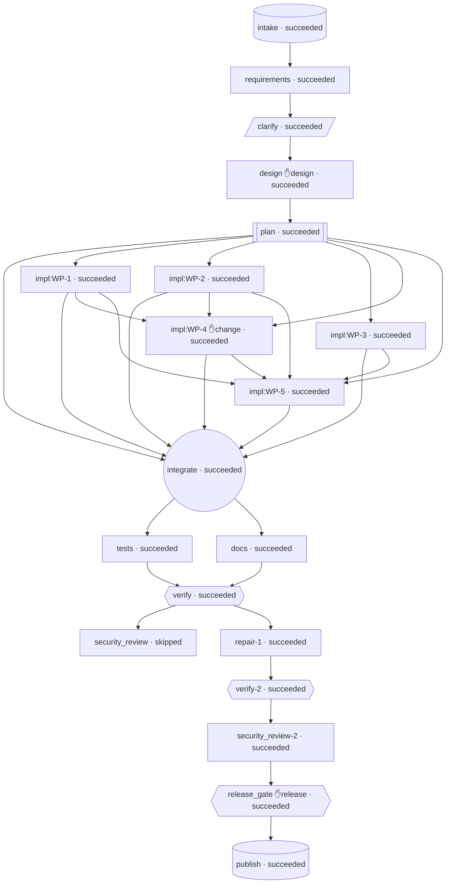

# Engineering Summary — greenfield (run_c856232d1346)

**Status:** succeeded  
**Requirement:** Build a production-ready URL shortener HTTP service.

Core API
- Create a short link for a long URL; respond with the short code, the full short URL and metadata.
- Visiting the short URL redirects (HTTP 307) to the original URL; unknown codes return 404.
- Look up a link's metadata by code, and deactivate (soft-delete) a link; deactivated links stop redirecting.

Analytics
- Record each redirect as a click event: timestamp, referrer and user agent.
- Per-link stats endpoint: total clicks, clicks per day (UTC) and top referrers.
- Privacy: never store raw client IP addresses (store only a salt

## 1. Requirement understanding
Build a greenfield HTTP service (Python 3.11, FastAPI, SQLAlchemy 2.0, Pydantic v2) where clients create short links for long http/https URLs. Visiting a short link redirects to the original URL with HTTP 307. Clients can look up and soft-delete links. Every redirect is recorded as a privacy-preserving click event (timestamp, referrer, user agent; never the raw IP), and per-link stats are available (total clicks, clicks per UTC day, top referrers). The service must hold up in production: strict URL validation, random collision-safe short codes backed by a DB unique constraint, idempotent creation through an Idempotency-Key header, liveness/readiness probes, and consistent JSON errors that never leak stack traces. Persistence is relational through SQLAlchemy: SQLite by default, configurable via DATABASE_URL. The workspace is empty apart from .gitignore, so there is no existing code to protect.

| ID | Requirement | Priority | Verified by tests |
|---|---|---|---|
| FR-1 | Create short link | must | ✅ |
| FR-2 | URL validation | must | ✅ |
| FR-3 | Random, URL-safe, collision-safe short codes | must | ✅ |
| FR-4 | Idempotent creation via Idempotency-Key | must | ✅ |
| FR-5 | Redirect to original URL | must | ✅ |
| FR-6 | Look up link metadata | must | ✅ |
| FR-7 | Deactivate (soft-delete) link | must | ✅ |
| FR-8 | Record click events | must | ✅ |
| FR-9 | Per-link stats | must | ✅ |
| FR-10 | Liveness and readiness probes | must | ✅ |
| FR-11 | Consistent JSON error responses | must | ✅ |
| FR-12 | Configuration and persistence | must | ✅ |
| FR-13 | OpenAPI documentation | should | — |

- **NFR-1** (privacy): Raw client IP addresses are never persisted or logged. At most an HMAC-SHA256 hash keyed by a server-side salt (IP_HASH_SALT) is stored, and nothing is stored when no salt is configured. — _Automated test scans all stored click_events rows and captured log output for the client IP string and finds no match. Code review confirms there is no IP column in the models._
- **NFR-2** (security): Only http/https URLs are stored, which prevents open redirects to javascript:/data:/file: payloads. Code generation uses a CSPRNG. All DB access goes through the SQLAlchemy ORM or bound parameters, never string-formatted SQL. No eval/exec or shell=True. — _FR-2 negative tests pass. Static review/grep finds no 'random.' use for code generation, no f-string or %-formatted SQL, and no eval/exec._
- **NFR-3** (security): Error responses never expose stack traces, exception messages, SQL or internal paths. — _Test from FR-11 asserts the 500 body equals {"detail":"Internal Server Error"}. The readiness failure test asserts the body contains no exception text._
- **NFR-4** (performance): With the default SQLite DB holding 10,000 links on a developer machine, the redirect endpoint (including click recording) has p95 latency under 50 ms and link creation has p95 under 100 ms (in-process TestClient). — _A performance test or script (may be marked slow/optional) times 500 redirects and 200 creations and checks the p95. Indexes exist on links.code (unique) and click_events(link_id, created_at)._
- **NFR-5** (reliability): Code uniqueness and idempotency are guaranteed by DB unique constraints, not only by application checks. IntegrityErrors are handled (retry or replay) and never surface as 500. — _Tests from FR-3 and FR-4 (forced collision, duplicate key insert) pass. The schema shows unique constraints on links.code and the idempotency key._
- **NFR-6** (maintainability): Layered architecture: app/api -> app/services -> app/repositories -> app/models, with schemas in app/schemas and config/db/errors/logging in app/core. Dependencies point inward only. — _Review/grep: app/services contains no FastAPI imports, app/repositories contains no imports from app/api or app/services, and app/models imports nothing from outer layers._
- **NFR-7** (maintainability): Automated tests cover every must-level FR. Each test is isolated with a fresh temporary SQLite DB and names the requirements it covers in its docstring ('Covers: FR-n'). — _`python -m pytest -q` passes. Grepping test docstrings shows at least one test per must-level FR-1..FR-12. Line coverage of app/ is at least 85% when measured._
- **NFR-8** (operability): Logging is structured (one line per request, with method, path, status and duration in ms) and the level is set by LOG_LEVEL. Container orchestrators can use /healthz and /readyz. — _Test with caplog asserts a request log record contains status and path and no client IP. The FR-10 tests pass._
- **NFR-9** (scalability): The service is stateless apart from the database, so multiple instances can run against one shared Postgres/MySQL database. No in-memory state is required for correctness (idempotency and uniqueness live in the DB). — _Code review: no module-level mutable caches are used for idempotency or code allocation. Dependencies are pinned in requirements.txt._

## 3. Plan & decomposition
Waves (parallel groups): [['WP-1', 'WP-2', 'WP-3'], ['WP-4'], ['WP-5']]

- **WP-1 Foundation: requirements and app/core** → requirements.txt, app/__init__.py, app/core/__init__.py, app/core/config.py, app/core/db.py, app/core/errors.py, app/core/logging.py, app/core/middleware.py (deps: —; succeeded, 1 attempt(s))
- **WP-2 ORM models and repositories** → app/models/__init__.py, app/models/base.py, app/models/link.py, app/models/click_event.py, app/models/idempotency_key.py, app/repositories/__init__.py, app/repositories/link_repository.py, app/repositories/click_repository.py, app/repositories/idempotency_repository.py (deps: —; succeeded, 1 attempt(s))
- **WP-3 Pydantic schemas and URL validation** → app/schemas/__init__.py, app/schemas/links.py, app/schemas/health.py (deps: —; succeeded, 1 attempt(s))
- **WP-4 Services: codes, link lifecycle, redirect/clicks, stats** → app/services/__init__.py, app/services/codes.py, app/services/link_service.py, app/services/stats_service.py (deps: ['WP-1', 'WP-2']; succeeded, 1 attempt(s))
- **WP-5 API routers, dependency providers and app factory** → app/api/__init__.py, app/api/deps.py, app/api/links.py, app/api/redirect.py, app/api/health.py, app/main.py (deps: ['WP-1', 'WP-2', 'WP-3', 'WP-4']; succeeded, 1 attempt(s))

## 4. Architecture decisions
- **ADR-1 Strict layering with services owning transactions** — Routers in app/api depend only on services, schemas and core. Services accept a SQLAlchemy Session plus plain config values, use repositories, and alone call commit()/rollback(). Repositories only add/flush/query. Models import only sqlalchemy. Domain exceptions live in app/core/errors.py, which keeps services free of FastAPI imports.. _Why:_ Meets NFR-6, makes services unit-testable without HTTP, and puts the transaction boundaries needed for the retry/replay logic (NFR-5) in one place. _Alternatives:_ Fat routers that call the ORM directly, Unit-of-work abstraction (unnecessary for this size)
- **ADR-2 Random base62 codes backed by a DB unique constraint and retry** — codes.generate_code(length) uses secrets.choice over [A-Za-z0-9]. The service inserts and flushes. On IntegrityError it rolls back and retries with a new code, up to CODE_MAX_ATTEMPTS (default 5). A reserved candidate (compared case-insensitively against RESERVED_CODES) uses up an attempt and is regenerated. When attempts run out the service raises a 503.. _Why:_ With 62^7 ≈ 3.5e12 codes collisions are rare. The DB constraint guarantees uniqueness across instances (NFR-5, NFR-9). Codes are unguessable (NFR-2, R-1). _Alternatives:_ Hash of the URL (deterministic, enables enumeration, conflicts with the no-dedup rule), Sequential ID encoded in base62 (guessable), Pre-check with SELECT before insert (racy without the constraint anyway)
- **ADR-3 Idempotency via a table with a unique key and request hash, written in the link's transaction** — If the key exists: a matching request_hash replays the stored link (201, Idempotent-Replayed: true), and a different hash returns 409. Otherwise the link is inserted and flushed, then the key row is inserted and flushed in the same transaction, then the transaction commits. An IntegrityError on the key flush (a concurrent winner) rolls back both rows, after which the service re-reads the key and replays or returns 409. Keys are global and never expire (Q-3). Replays are rebuilt from the stored link row.. _Why:_ The DB constraint guarantees at most one link per key even with concurrent requests or several instances (FR-4, R-7). It never returns 500. _Alternatives:_ Store the full response body JSON, In-memory cache (violates NFR-9), Key expiry after 24h (deferred)
- **ADR-4 App factory with a per-app engine on app.state** — create_app(settings=None) builds Settings() when none are given, creates the engine and sessionmaker, and stores settings, engine and session_factory on app.state. get_db(request) and get_settings(request) read from app.state. Tables are created by Base.metadata.create_all(engine) in the lifespan startup, and the engine is disposed on shutdown.. _Why:_ Each test gets an isolated DB by passing Settings(database_url=tmp). There are no import-time side effects and no global mutable state (NFR-7, NFR-9). _Alternatives:_ Module-level global engine with dependency overrides, lru_cache'd get_settings (stale across tests), Alembic migrations (out of scope)
- **ADR-5 Naive-UTC timestamps and Python-side day bucketing** — All DateTime columns are portable naive DateTime values holding UTC (models.base.utcnow() = datetime.now(timezone.utc).replace(tzinfo=None)). Response schemas convert to tz-aware UTC on output. clicks_per_day fetches only created_at for rows in the window and groups by .date() in Python. top_referrers uses SQL GROUP BY referrer, followed by a deterministic Python sort and a cut to 10.. _Why:_ Avoids database-specific date functions and NULL ordering differences (R-6, FR-12), and gives identical serialization for replays. _Alternatives:_ func.date() GROUP BY in SQL (return type differs per DB), timezone-aware columns (SQLite drops tzinfo anyway)
- **ADR-6 Raw 307 Response for redirects; ASCII-only target URLs** — The redirect handler returns Response(status_code=307, headers={'Location': url, 'Cache-Control': 'no-store'}) instead of starlette's RedirectResponse, which percent-quotes the URL. URL validation additionally rejects non-ASCII characters (clients must send punycode or percent-encoded URLs).. _Why:_ FR-5 requires Location to equal the stored URL exactly. Response headers are latin-1 encoded, so non-ASCII would otherwise cause 500s. _Alternatives:_ RedirectResponse (alters the URL), Normalize/IDNA-encode on input (violates the store-unchanged assumption)
- **ADR-7 Centralized JSON error handling with a middleware catch-all** — AppError subclasses carry status_code and detail: BadRequestError 400, NotFoundError 404, ConflictError 409, GoneError 410, ServiceUnavailableError 503. Handlers are registered for AppError, StarletteHTTPException (404/405, keeping headers such as Allow), RequestValidationError (422), SQLAlchemyError (503 'Service temporarily unavailable', logged), and Exception (500). RequestLoggingMiddleware also wraps call_next in try/except: an exception is logged with its traceback and answered with 500 {"detail": "Internal Server Error"}.. _Why:_ Meets FR-11 and NFR-3: error bodies never contain exception text, and DB outages become 503 rather than 500. _Alternatives:_ Per-route try/except, Relying on FastAPI defaults (the 500 is plain text)
- **ADR-8 Synchronous, best-effort click recording** — After resolving an active link, the service inserts a ClickEvent and commits in its own small transaction. Any exception rolls back and is logged (logger.exception, without the IP), and the 307 is still returned. HEAD requests never record clicks.. _Why:_ Q-5 default: the redirect must not fail because of analytics (FR-8, R-4). HEAD is not a real visit. _Alternatives:_ Background tasks / async queue (out of scope), Failing the redirect when recording fails
- **ADR-9 No authentication in this iteration** — The /api/links router has no auth dependency, but is structured so that a future Depends(require_api_key) can be added at router level without changing the contract.. _Why:_ Q-1 default; tracked as a risk. _Alternatives:_ Static X-API-Key, Per-user accounts
- **ADR-10 Readiness via the shared get_db dependency** — /readyz declares db: Session = Depends(get_db) and runs db.execute(text('SELECT 1')) inside try/except Exception, raising ServiceUnavailableError('Database is not ready') on failure. If an overridden get_db itself raises a SQLAlchemyError, the global SQLAlchemyError handler returns 503 too.. _Why:_ Tests can simulate a DB outage through app.dependency_overrides[get_db] (FR-10). No exception text is leaked. _Alternatives:_ Probe via app.state.engine directly (overrides would not apply)

**API contract:**
- `POST /api/links` — Create a short link. An optional Idempotency-Key header makes the request idempotent.
- `GET /api/links/{code}` — Get link metadata, including for deactivated links.
- `DELETE /api/links/{code}` — Soft-delete (deactivate) a link. Idempotent.
- `GET /api/links/{code}/stats` — Aggregated click stats for a link (active or deactivated).
- `GET /{code}` — Redirect to the original URL and record a click event. (HEAD /{code} is also implemented with the same status and Location, without recording a click, and is hidden from the schema.)
- `GET /healthz` — Liveness probe. Does not touch the database.
- `GET /readyz` — Readiness probe. Runs SELECT 1 through the get_db session.

## 5. Validation
- ✅ **compile** — ok
- ✅ **lint_correctness** — All checks passed!
- ✅ **tests_pass** — 165 passed, 0 failed, 0 errors
- ✅ **coverage** — 99.19% (minimum 80.0%)
- ✅ **api_contract** — 7 contract endpoints implemented
- ✅ **requirements_traceability** — 12 must-FRs traced
- ✅ **policy_scan_full_tree** — 2 non-blocking findings

**Security review:**
- [medium] No rate limiting or abuse resistance; public redirect writes to the DB on every request, so clicks can be flooded @ app/api/redirect.py:43-51; app/services/link_service.py:171-195; app/main.py:51-63 (no limiter or body-size middleware) → Add per-client rate limiting before the public launch, either at the gateway (documented as required for deployment) or in the app (e.g. a token bucket keyed by the pseudonymised IP). Use separate limits for GET /{code} and POST /api/links. Click recording currently does one INSERT per request, so anyone can inflate stats and cause SQLite 'database is locked' contention. Consider skipping or sampling clicks for repeat (ip_hash, link) pairs within a short window. Also cap request body size (e.g. reject Content-Length over about 8 KB on /api/links) so oversized JSON bodies are refused before they are parsed.
- [medium] Referrer stored in full (query string and fragment), user agent stored raw: weak data minimisation @ app/services/link_service.py:185-186; app/api/redirect.py:46-47; app/models/click_event.py:26-27 → Referrer URLs often carry personal data in the path or query (email addresses, session or reset tokens, search terms). Stats only need the referring origin, so store just scheme://host via urlsplit and drop the path, query and fragment. Reduce the user agent to a coarse family/version (or drop it, since no endpoint exposes it). If full values are required, document the lawful basis and include them in the DPIA.
- [medium] No retention limit for click events (personal data kept forever) @ app/models/click_event.py:14-28; docs/OPERATIONS.md 'Retention' (nothing is ever deleted) → Add a configurable retention setting (e.g. CLICK_RETENTION_DAYS) and a purge routine or CLI that deletes click_events older than N days. Default N to the 365-day stats window. Alternatively, roll old rows into anonymous daily counters, removing ip_hash, user_agent and referrer, before deletion. This meets GDPR storage limitation, given ip_hash is still pseudonymous personal data.
- [medium] Keeping client IPs out of logs depends on an operator flag (uvicorn access log is on by default) @ app/main.py:1-9, 67 (module-level app; relies on `--no-access-log`); docs/OPERATIONS.md 'Running the service' → Make the privacy-safe setup the default rather than something to remember. Ship an entrypoint (e.g. app/__main__.py calling uvicorn.run(..., access_log=False)) or a log config that disables or filters 'uvicorn.access', and use it in the container CMD. Behind a proxy, document a strict --forwarded-allow-ips list (never '*'). Otherwise X-Forwarded-For can be spoofed, which skews ip_hash and abuse controls.
- [low] Shared management API key has no scoping, rotation support or audit trail for deactivations @ app/api/deps.py:38-60; app/core/config.py:33; app/services/link_service.py:153-159 → Support several keys (e.g. API_KEYS as a comma-separated list of SecretStr) so keys can be rotated without downtime. Log an audit event for deactivations (e.g. 'link deactivated', link_id plus a key identifier/fingerprint, never the key itself). Longer term, add per-owner authorisation so one client cannot deactivate or read stats for another client's links.
- [low] Docs and API contract out of date: they say there is no authentication, but the code requires X-API-Key and fails closed @ README.md:11-14; docs/API.md:12; docs/OPERATIONS.md:280-285; CHANGELOG.md:60; design api_contract (no 401 listed) → Update the README, API.md, OPERATIONS.md and CHANGELOG to describe API_KEY (at least 16 characters), the X-API-Key header and the 401 response. Add 401 to the API contract and record the change as an ADR superseding ADR-9. Operators following the current docs will deploy without API_KEY and get 401 on every management call. That is safe, but confusing, and it encourages insecure workarounds.
- [low] IP_HASH_SALT is held as a plain str, not SecretStr, and has no minimum strength @ app/core/config.py:27, 35-41 → Change ip_hash_salt to SecretStr | None so it is masked in repr, logs and debug output, and call get_secret_value() when building LinkService in app/api/deps.py. Require at least 32 random bytes or characters. With a short salt, brute-forcing the IPv4 space would undo the pseudonymisation. Consider failing or warning at startup when the salt is missing in production, so clicks are not silently left without any IP-derived value.
- [low] Interactive docs and OpenAPI schema are publicly exposed @ app/main.py:51 → Add a setting (e.g. ENABLE_DOCS, default false in production) and pass docs_url/redoc_url/openapi_url=None when it is disabled. Or restrict these paths at the gateway. This reduces how much of the management API surface is visible to the public.
- [low] Dependency hygiene: transitive packages (starlette, etc.) unpinned; test tools in runtime requirements @ requirements.txt:1-8 → Split runtime and dev requirements (move pytest, pytest-cov and httpx to requirements-dev.txt). Generate a fully pinned lock file with hashes (pip-compile --generate-hashes) that includes starlette and anyio. Add pip-audit or Dependabot to CI. No known exploitable CVE affects the code paths used here (no multipart forms, no FileResponse), but the transitive starlette version currently floats with fastapi's range.
- [low] BASE_URL is not validated; an http:// or malformed origin produces insecure or broken short_url values @ app/core/config.py:24; app/api/deps.py:82-84 → Validate base_url at startup with the same http/https URL rules (no path, query or fragment). Warn or refuse when the scheme is http and the host is not localhost, so production short links are always issued over https.

## 6. Risks & trade-offs
- Without authentication, anyone can deactivate links or read their stats if they know or guess a code. — _mitigation:_ Keep the API contract compatible with adding an X-API-Key dependency on the /api router. Document the gap. Codes are high-entropy, so guessing is impractical. Escalate Q-1 to stakeholders before public launch.
- The shortener could be abused for open redirects or phishing (redirecting to malicious http/https sites). — _mitigation:_ Allow only http/https schemes (FR-2), use soft-delete for takedowns (FR-7), and leave URL reputation scanning and rate limiting to a future iteration or the infrastructure.
- The GET /{code} catch-all route could shadow /healthz, /readyz, /docs or /openapi.json, or a generated code could equal a reserved word. — _mitigation:_ Register fixed routes before the catch-all, keep a reserved-word list in code generation (FR-3), and test that the probes and docs are reachable.
- Under SQLite, concurrent writes (click events plus creation) can hit 'database is locked' errors. — _mitigation:_ Use check_same_thread=False and short transactions, keep click-recording failures from breaking redirects (FR-8), and document Postgres for production through DATABASE_URL.
- Click-recording writes on every redirect may become the latency bottleneck at high traffic. — _mitigation:_ Index click_events(link_id, created_at), measure against NFR-4, and plan async/batched ingestion as a future enhancement.
- UTC day bucketing may behave differently across SQLite, Postgres and MySQL date functions. — _mitigation:_ Bucket by UTC date in a portable way (e.g. aggregate in Python over the windowed rows, or use func.date on UTC-stored naive timestamps) and test across midnight boundaries.
- Race conditions when the same Idempotency-Key arrives concurrently. — _mitigation:_ Put a unique constraint on the key. Handle IntegrityError by re-reading the stored key and either replaying it or returning 409, and add a test that simulates the insert race.
- Without authentication anyone who knows a code can deactivate a link or read its stats (Q-1). — _mitigation:_ Codes are high-entropy. The router is ready for an API-key dependency. Escalate before public launch.
- The catch-all GET /{code} could shadow fixed routes, or test-added routes registered after it. — _mitigation:_ Register the redirect router last in create_app. The reserved-word list is applied in code generation. Tests that add ad-hoc routes must use multi-segment paths such as /_test/boom, which /{code} cannot match.
- SQLite 'database is locked' errors under concurrent writes. — _mitigation:_ check_same_thread=False, short transactions, best-effort click recording, SQLAlchemyError mapped to 503. Recommend Postgres via DATABASE_URL for production.
- uvicorn's access log prints client IPs, which would violate NFR-1. — _mitigation:_ Run with `uvicorn app.main:app --no-access-log`. The app's own request log contains method, path (no query string), status and duration_ms only.
- Python-side day bucketing loads every created_at in the window for very popular links. — _mitigation:_ Only one column is selected and the window is capped at 365 days. The (link_id, created_at) index serves the query. A future iteration can add pre-aggregated daily counters.
- The idempotency race path is hard to exercise. — _mitigation:_ The service re-reads the key after an IntegrityError and returns 409 if it is still missing. Tests simulate the race by pre-inserting the key row after the first lookup (monkeypatch IdempotencyRepository.get_by_key to return None once).
- Datetime serialization differences between the first response and a replay would break FR-4's identical-body check. — _mitigation:_ Both responses are built from DB-loaded attributes (expire_on_commit=True reloads after commit). Schemas normalize datetimes to tz-aware UTC.

## 7. Assumptions
- This is a greenfield project; the workspace contains only .gitignore.
- The API is JSON over HTTP, with management routes under /api/links and redirects at the root path /{code}.
- Codes are 7 base62 characters (about 3.5e12 combinations) generated with `secrets`, with up to 5 retries on collision.
- short_url is built from the BASE_URL env var (default http://localhost:8000).
- Original URLs are stored exactly as submitted (no normalization), apart from validation.
- All timestamps are stored and returned in UTC, in ISO 8601 format.
- Schema creation uses Base.metadata.create_all at startup; migrations (Alembic) are not required in this iteration.
- Click recording is synchronous, in the same transaction scope as the redirect request.
- Validation errors use FastAPI's 422 with a 'detail' key (Pydantic's error list is acceptable as the detail value).
- Rate limiting and abuse protection are handled by infrastructure (reverse proxy/API gateway) for now.
- Assumption: short_url is built from the BASE_URL env var (default http://localhost:8000). (agent:requirements)
- Q-1 assumed default: No authentication in this iteration. The endpoints are designed so an API-key dependency can be added later on the /api router without changing the contract. Recorded as a risk. (agent:requirements)
- Q-2 assumed default: 410 Gone with a JSON 'detail' key. (agent:requirements)
- Q-3 assumed default: Global scope, no expiry in this iteration. A replay with the same payload returns 201 and the identical body plus 'Idempotent-Replayed: true'. A different payload returns 409. (agent:requirements)
- Q-4 assumed default: Not supported. Random codes only, no expiry. (agent:requirements)
- Q-5 assumed default: Use the NFR-4 targets. Click recording is synchronous, in the same request. (agent:requirements)
- Q-6 assumed default: Last 30 days by default (configurable with 'days'), top 10 referrers, and total_clicks counted all-time. (agent:requirements)
- Q-7 assumed default: Use the socket peer address (request.client.host). Ignore X-Forwarded-For unless a future TRUSTED_PROXIES setting is added. (agent:requirements)

## 8. Human oversight
- `design` on **design**: approved by policy:auto-approve — “auto-approved: kind is auto-approvable under policy.autonomy”
- `change` on **impl:WP-1**: approved by policy:auto-approve — “auto-approved: kind is auto-approvable under policy.autonomy”
- `change` on **impl:WP-4**: approved by policy:auto-approve — “auto-approved: kind is auto-approvable under policy.autonomy”
- `policy_exception` on **impl:WP-5**: approved by human:kajalmahata — “IP is HMAC-SHA256 pseudonymised in services/link_service.hash_ip before storage (NULL without salt); router only forwards it.”
- `change` on **repair-1**: approved by policy:auto-approve — “auto-approved: kind is auto-approvable under policy.autonomy”
- `release` on **release_gate**: approved by human:kajalmahata — “Release approved after review of readiness checklist, security findings (0 high) and metrics.”

## 9. Reliability metrics
| metric | value |
|---|---|
| e2e_latency_s | 2735.71 |
| attempt_success_rate | 0.905 |
| first_pass_yield | 0.947 |
| retries | 1 |
| rollbacks | 1 |
| mttr_s | 489.74 |
| repair_loops | 1 |
| replans | 0 |
| reused_nodes | 0 |
| safe_stops | 0 |
| policy_denials | 0 |
| approvals_requested | 6 |
| approvals_rejected | 0 |
| llm_cost_usd | 8.924 |
| cache_hit_ratio | 1.0 |

## 10. Limitations
- User accounts, authentication and authorization (see Q-1)
- Custom aliases/vanity codes and link expiration
- Editing a link's target URL after creation
- Hard delete / purging of links or click data
- Rate limiting, malware/phishing URL scanning, CAPTCHA
- Geo-IP or device analytics beyond the raw user-agent string
- A UI/dashboard, QR codes
- Database migrations tooling and multi-region deployment
- Caching layers (Redis) and asynchronous click ingestion
- Generated code is validated by automated gates and a security review agent; a human should still review the release diff before production deployment.

## 11. Release
- tag `v1.0.0` @ `b7f1cdf39c08`
- bundle `/Users/kajalmahata/Alpha_AI_Products/agentic_sdlc/.sdlc/runs/run_c856232d1346/release/v1.0.0/service-v1.0.0.tar.gz`
- sha256 `f7ab4850730b2afecad56c9657d32c17fec57f4873bcd79eee4a25689e02a79f`

## Artifact lineage
| artifact | version | hash | producer | derived from |
|---|---|---|---|---|
| requirement | v1 | `5ee67f561141fd3d` | intake | — |
| requirements_spec | v1 | `f9e39c09ed667d11` | requirements | requirement@5ee67f56 |
| clarification_log | v1 | `d65a6ee3b313377b` | clarify | requirements_spec@f9e39c09 |
| design | v1 | `69d249761c25951f` | design | requirements_spec@f9e39c09 |
| plan | v1 | `ae1ea844fd9d2d96` | plan | design@69d24976, requirements_spec@f9e39c09 |
| impl_report:WP-1 | v1 | `9ed15620b51e73a4` | impl:WP-1 | requirements_spec@f9e39c09, design@69d24976 |
| impl_report:WP-2 | v1 | `236e0d25e2602895` | impl:WP-2 | requirements_spec@f9e39c09, design@69d24976 |
| impl_report:WP-3 | v1 | `40a2f1338a6b1d3b` | impl:WP-3 | requirements_spec@f9e39c09, design@69d24976 |
| impl_report:WP-4 | v1 | `bfbe6999c6168a53` | impl:WP-4 | requirements_spec@f9e39c09, design@69d24976 |
| impl_report:WP-5 | v1 | `a04b1952d3cf67e9` | impl:WP-5 | requirements_spec@f9e39c09, design@69d24976 |
| integration | v1 | `778c97b8b14bbc89` | integrate | — |
| docs_report | v1 | `42df81f8b73b2bfe` | docs | requirements_spec@f9e39c09, design@69d24976 |
| test_report | v1 | `5c8c14dbc36e3257` | tests | requirements_spec@f9e39c09, design@69d24976 |
| repair_report_1 | v1 | `adeec9bcce70512c` | repair-1 | requirements_spec@f9e39c09, design@69d24976, verification_report@1fcc3d34, security_review@d552e2b7, test_report@5c8c14db |
| verification_report | v2 | `a5fa2a88bd461360` | verify-2 | design@69d24976, requirements_spec@f9e39c09, test_report@5c8c14db |
| security_review | v2 | `9eeec5b0f8692829` | security_review-2 | design@69d24976, verification_report@a5fa2a88 |
| release_readiness | v1 | `0d4a2703e78a7e0a` | release_gate | verification_report@a5fa2a88, security_review@9eeec5b0, docs_report@42df81f8 |
| release | v1 | `96d3c8d905e16312` | publish | release_readiness@0d4a2703 |
