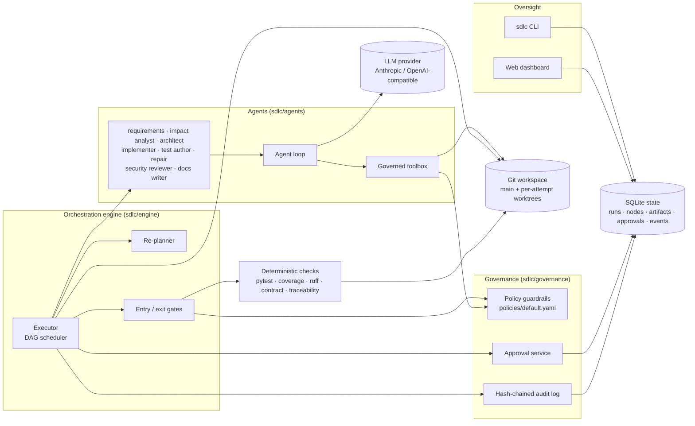
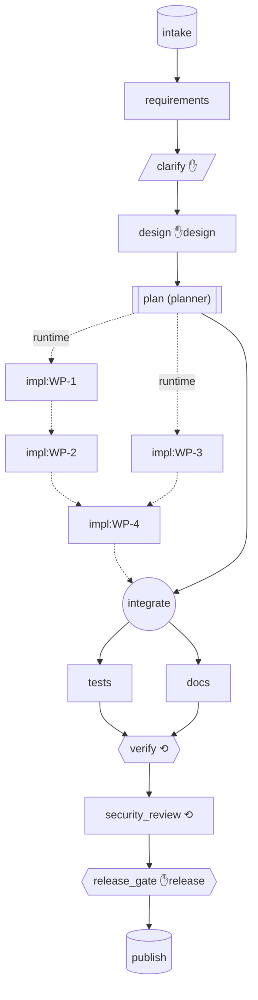
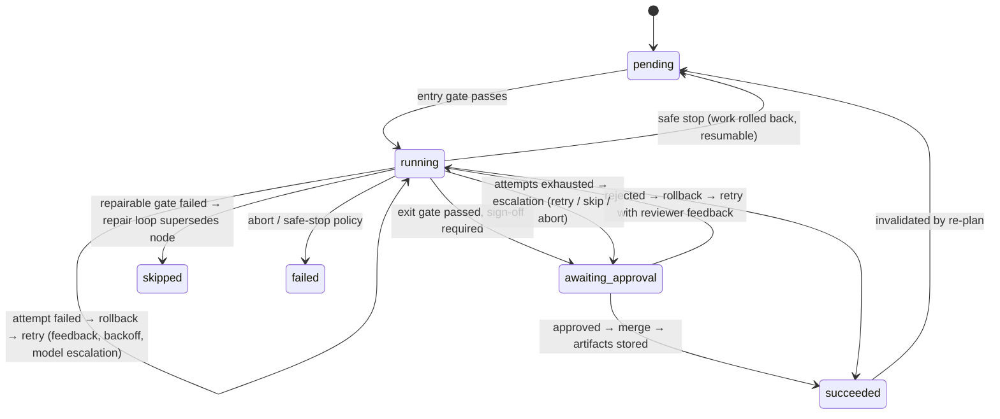

# Architecture

> A governed, stateful orchestrator that turns a requirement into a reviewed, tested,
> released service. LLM agents do the engineering work; deterministic gates verify it;
> humans own approvals and final quality.

## 1. Components

| Package | Responsibility |
|---|---|
| `sdlc/domain` | Plain data: `NodeSpec`, `NodeState`, `Artifact`, `Decision`, `Approval`; the `DependencyGraph` (validated DAG, mutable at runtime). |
| `sdlc/engine` | `executor.py` (scheduler + per-node lifecycle), `replan.py` (invalidation, rollback, repair loops), `gates.py`, `context.py` (run context, handler contract), `bootstrap.py`. |
| `sdlc/governance` | `policy.py` (guardrails), `approvals.py` (human checkpoints), `audit.py` (tamper-evident log). |
| `sdlc/agents` | Agent loop, governed tools, role prompts (`prompts/*.md`), output schemas, agent handlers with deterministic exit gates. |
| `sdlc/llm` | Provider interface; Anthropic (default), OpenAI-compatible, scripted fake (tests only); pricing. |
| `sdlc/checks` | Deterministic validators: compile, lint, pytest+coverage, route/contract dump, AST codebase index. |
| `sdlc/pipelines` | SDLC graph templates (greenfield / brownfield) and deterministic steps (intake, clarify, plan, integrate, verify, release gate, publish). |
| `sdlc/workspace` | Git workspace: per-attempt worktrees, merge, discard, reset. |
| `sdlc/observability` | Metrics derived from the audit log; engineering-summary report; Mermaid rendering. |
| `sdlc/dashboard` | FastAPI oversight API + static SPA. |

There is **no dependency on Claude Code or the Claude Agent SDK**: the agent loop is ~150
lines on top of the Messages API, which is what lets the orchestrator own every tool call.

## 2. Orchestration model

### 2.1 The dependency graph

* `✋` human checkpoint · `⟲` repairable gate · dotted = created at runtime by the planner.
* Brownfield prepends `codebase_scan → impact_analysis` and feeds the impact analysis into
  requirements and design.
* **Parallel paths with synchronisation:** work packages in the same wave run concurrently
  (bounded by `max_parallel`); `integrate` is a join barrier; `tests ‖ docs` run in parallel
  and `verify` joins them.
* **Non-linear paths:** clarification loops back to requirements; failed gates insert repair
  loops; amendments and upstream changes invalidate and re-run parts of the graph.

### 2.2 Node lifecycle

**Entry gate** (`engine/gates.py`): dependencies done · *all ancestors settled* (nothing
downstream of an in-flight re-plan can start) · required input artifacts present · budget left.

**Exit gate**: the handler's own deterministic checks (see §4) **plus**, for nodes that
change code, a policy scan of the attempt's diff: write scope, forbidden paths, dangerous
code, secrets, privacy rules, dependency allow-list, change-size budget.

### 2.3 Cross-stage context and decision lineage

Stages never call each other. They communicate only through **artifacts**: versioned,
content-hashed values with a `derived_from` map (input name → hash). Every node records the
input hashes it consumed. This one mechanism provides:

* **Lineage**: `sdlc lineage <run> release` walks back through every artifact to the requirement.
* **Decision lineage**: ADRs, assumptions, clarification answers and every approval are
  `Decision` records with the actor (`agent:architect`, `human:alice`, `policy:auto-approve`)
  and the artifact hashes they were based on.
* **Re-planning**: see below.

### 2.4 Dynamic re-planning

| Trigger | Mechanism |
|---|---|
| Planner | `plan` reads the approved design and **adds** `impl:WP-n` nodes and their edges at runtime; `integrate` is wired to depend on them. |
| Upstream output changed | When a node re-runs and an output hash differs from what a consumer used, that consumer is invalidated. Unchanged outputs **stop the cascade** and read-only nodes whose inputs come back identical are **reused** (memoised). |
| Clarification | Answers are folded into the requirement brief; `requirements` is invalidated and regenerated. Bounded to 2 rounds, then the analyst's defaults are used (recorded as decisions). |
| Amendment | A human (CLI, dashboard or scenario) amends the requirement on a live or finished run; consumers are invalidated and the graph re-plans. |
| Repair loop | A failed repairable gate (`verify`, `security_review`) inserts `repair-k → verify-k (→ rerun)` and rewires dependents to the new tail. Bounded by `max_repair_cycles`. |

**Workspace consistency:** invalidating a node that merged code resets `main` to that node's
base commit and invalidates every other node whose merge is no longer in history. Pending
approvals on invalidated nodes are *superseded*. Approvals are bound to the content hash
they covered, so a changed design always needs a fresh human decision.

## 3. Control flow and reliability controls

| Control | Where | Behaviour |
|---|---|---|
| Bounded retries | `RetryPolicy` per node | Agents 3 attempts, deterministic checks 1. Exponential backoff for transient errors. |
| Feedback | executor | Every failed attempt's gate failures, crash reason or reviewer comment is fed to the next attempt. |
| Fallback | executor + `AgentHandler` | From the escalation attempt on, the fallback model at `xhigh` effort. Refusals are treated as transient → fallback. Optional nodes degrade (`on_failure: skip`). |
| Rollback | `git_workspace.py` | Each mutating attempt works in its own worktree; failure = discard (exact rollback); success = merge. Re-plans reset `main`. Publish deletes its tag/bundle on failure. |
| Escalation | executor | Exhausted node → human escalation (retry with guidance / skip / abort). |
| Safe stop | executor | Operator stop, budget exhausted, circuit breaker (N consecutive failed attempts), fatal provider error, or human abort → cancel in-flight agents, discard worktrees, park nodes as pending, mark run `stopped`. `sdlc resume` continues. |
| Timeouts | executor | Per-node wall-clock timeout; per-command timeout; per-agent turn limit. |
| Budget | executor + agent loop | Cost charged per LLM turn; exceeding `max_run_cost_usd` safe-stops the run. |

## 4. Governance

### Policy guardrails (`policies/default.yaml`)
* **Security:** no `eval`/`exec`, `shell=True`, disabled TLS verification, SQL built with
  string formatting, or hard-coded secrets. Unsafe deserialisation needs an exception approval.
* **Compliance/privacy:** code that reads the client IP must pseudonymise it (CMP-001).
* **Change control:** protected paths (`requirements.txt`, migrations) and diffs over the
  size budget need a human change approval. Dependencies must be allow-listed.
* **Scope:** agents write only inside their work package's files; `.git`, `.env` and keys
  are never writable. Commands run without a shell from an allow-list, with secrets
  stripped from the environment.

### Separation of duties
Implementers can't write tests, and the test author can't change product code. A repair that
edits tests needs a human change approval. The architect must assign each file to exactly one
work package, which is checked deterministically.

### Human approval checkpoints
| Kind | When | Auto-approvable with `--approve auto`? |
|---|---|---|
| `clarification` | blocking ambiguities | yes (uses the analyst's defaults) |
| `design` | architecture, API contract & plan | yes |
| `change` | protected paths, large diffs, non-allow-listed deps, tests edited by repair, high-risk WPs | yes |
| `escalation` | node exhausted its attempts | once, then the run stops |
| `policy_exception` | `approve`-severity security/privacy findings | **never** |
| `release` | release readiness checklist + notes | **never** |

### Audit-grade observability
Every transition, tool call decision, gate result, approval, artifact and decision is an
event in a per-run **hash chain**. `sdlc audit <run> --verify` detects edited, deleted or
re-ordered history. Agent transcripts are stored per attempt. Metrics are computed from the
events, so they can't drift from what actually happened.

### Reliability metrics
`attempt_success_rate`, `first_pass_yield`, `retries`, `rollbacks`, `mttr_s` (failure →
recovery per node), `e2e_latency_s`, per-stage latency, `repair_loops`, `replans`,
`reused_nodes`, `safe_stops`, approval counts and wait time, policy denials, LLM cost,
tokens and cache-hit ratio. Available per run and aggregated across runs.

## 5. Key decisions (and why)

| # | Decision | Rationale | Alternatives considered |
|---|---|---|---|
| D1 | **Own agent loop on the Messages API**, not Claude Code / Agent SDK | The orchestrator must own every tool call to enforce policy, audit and budget; reviewers need no extra tooling. | Claude Agent SDK (bundles Claude Code; harness hides tool execution), LangGraph (heavier, less control over gates). |
| D2 | **Artifacts + hashes as the only inter-stage channel** | One mechanism for lineage, re-planning and memoisation; stages are independently testable. | Shared mutable context dict (no change detection). |
| D3 | **Git worktree per attempt** | Exact, cheap rollback; isolates parallel agents; merge conflicts surface as real integration failures; history is an audit artifact. | File snapshots (no conflict detection), containers per task (heavier). |
| D4 | **Agents propose, deterministic gates dispose** | LLM output is untrusted; tests, coverage, contract conformance and traceability are checked mechanically. | Self-reported success, LLM-as-judge only. |
| D5 | **Repair loops instead of blind retries for checks** | Re-running a deterministic check gives the same answer; the useful action is a targeted fix plus re-verification. | Retrying the whole implementation stage. |
| D6 | **Approvals bound to content hashes** | A re-plan can never carry an approval over to content the human didn't see. | Approval per node id. |
| D7 | **SQLite (WAL) for state, hash-chained events** | Zero-ops, shared safely by the CLI engine and the dashboard; enough for a single-host prototype. | Postgres + event bus (production path, see limitations). |
| D8 | **Pluggable provider interface** | Avoids vendor lock-in; the scripted fake makes the engine testable offline. | Single-vendor SDK calls throughout. |

## 6. Data model (state store)

`runs` (graph JSON, config, stop flag) · `node_states` · `artifacts` (name, version, hash,
producer, value, derived_from) · `decisions` · `approvals` (kind, status, subject hash,
response) · `amendments` · `events` (seq, type, node, attempt, data, prev_hash, hash).

## 7. Generated product architecture (the URL shortener)

The agents are instructed to follow a layered FastAPI architecture (`api → services →
repositories → models`, Pydantic `schemas`, `core` for config/db/errors), with SQLAlchemy 2.0
on SQLite (configurable `DATABASE_URL`), `app.main:app`, and pytest with isolated databases.
The design agent decides the specifics (entities, endpoints, ADRs) and a human approves them.
The approved API contract is then enforced against the real routes during verification.
