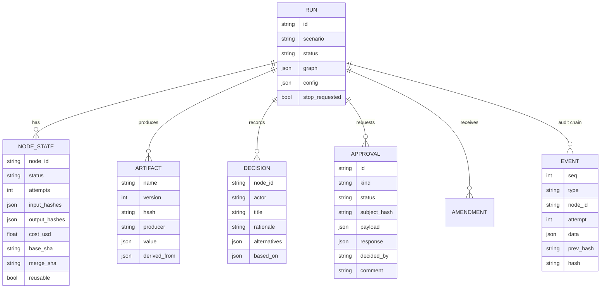
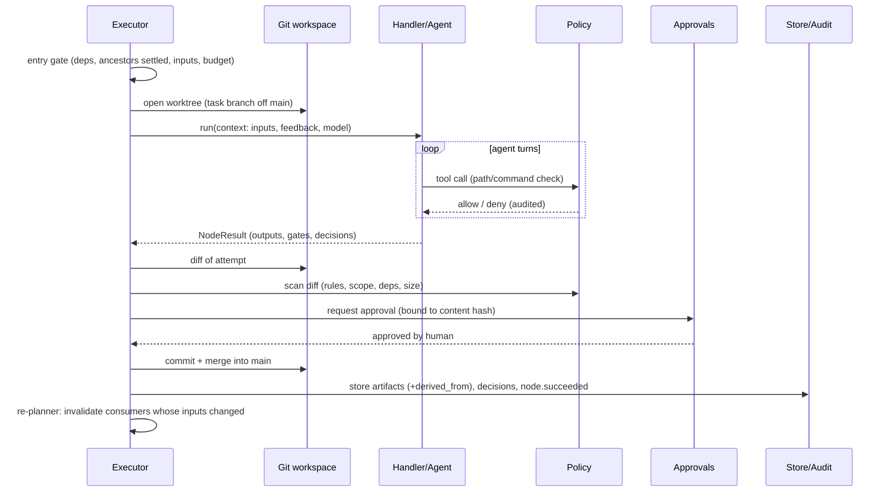
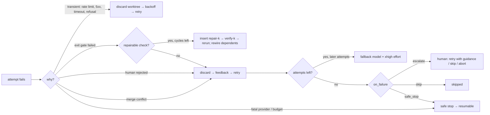
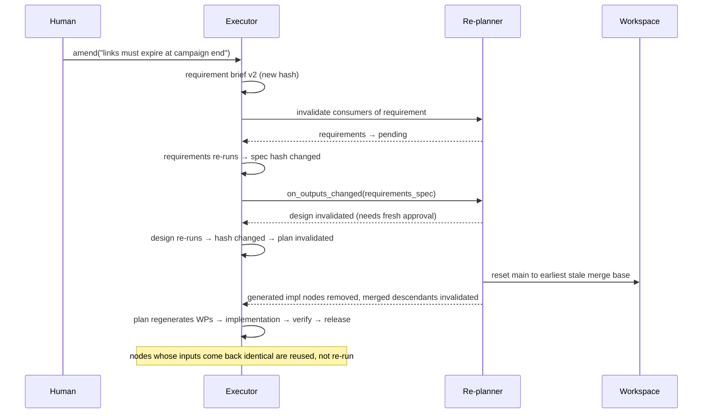

# Design Document: Agentic SDLC Orchestrator & URL Shortener

| | |
|---|---|
| **Status** | Implemented (prototype) |
| **Scope** | Part A: the orchestrator (hand-built). Part B: the URL shortener (designed and built *by the orchestrator's agents*, approved through its design checkpoint) |
| **Related** | [ARCHITECTURE.md](ARCHITECTURE.md) (overview & decisions) · [SCENARIOS.md](SCENARIOS.md) · [TESTING.md](TESTING.md) · [ENGINEERING_SUMMARY.md](ENGINEERING_SUMMARY.md) |

---

# Part A: Orchestrator design

## A1. Context and problem

Teams want AI agents to carry real engineering work, from requirement to release, without
giving up control. Linear "prompt → code" chains fail in three ways:
1. They can't tell good output from plausible output.
2. They can't recover locally from failures.
3. They give humans no structured point of control.

The system has to:
* run the whole SDLC as a stateful, non-linear workflow
* verify agent output mechanically
* keep humans accountable for high-impact decisions

## A2. Goals and non-goals

**Goals**
- G1. Requirement → released service with no manual coding, across greenfield, brownfield and
  ambiguous inputs.
- G2. Explicit dependency graph with entry/exit gates; parallel branches with join barriers;
  runtime re-planning.
- G3. Every agent action is policy-checked, audited and attributable. Every stage output is
  verified by deterministic checks.
- G4. Humans approve clarifications, designs, risky changes, policy exceptions and releases,
  and can stop, resume or amend at any time.
- G5. Failures are contained: bounded retries, exact rollback, repair loops, escalation,
  safe-stop with resume.
- G6. Reliability is measurable: success rate, retries, rollbacks, MTTR, latency, cost.

**Non-goals (prototype)**
- Multi-host scaling, multi-tenant RBAC, container sandboxing (see §A10).
- Generating non-Python stacks (the conventions and dependency allow-list are Python/FastAPI).
- Replacing human code review for production deployment.

## A3. Requirements traceability

Assignment requirement → design element: see [REQUIREMENTS_MAP.md](REQUIREMENTS_MAP.md).

## A4. System design

### A4.1 Component view

| Component | Responsibility | Key interfaces |
|---|---|---|
| **Executor** (`engine/executor.py`) | Schedules the DAG; runs node attempts; applies gates, approvals, merges; handles failures, escalation, safe-stop, amendments | `Orchestrator.execute() -> RunStatus` |
| **Re-planner** (`engine/replan.py`) | Invalidates consumers when outputs change; resets the workspace; inserts repair loops | `on_outputs_changed`, `invalidate`, `insert_repair_loop` |
| **Gates** (`engine/gates.py`) | Entry gate (deps, settled ancestors, inputs, budget); diff gates | `entry_gate`, `diff_gates` |
| **Handlers** (`agents/handlers.py`, `pipelines/steps.py`) | One per node type; agent handlers pair a role with deterministic exit checks | `Handler.run(NodeContext) -> NodeResult` |
| **Agent loop** (`agents/loop.py`) | Model ↔ tools until a schema-valid `submit`; turn/cost/cancel bounds; transcript | `run_agent(...) -> AgentOutcome` |
| **Toolbox** (`agents/tools.py`) | The only agent capabilities: list/read/search/write/edit/run_command/submit, all policy-guarded and audited | `Toolbox.execute(ToolCall)` |
| **Policy** (`governance/policy.py`) | Path scope, command allow-list, code rules, dependency allow-list, change budget, autonomy | `check_path`, `check_command`, `scan_changes` |
| **Approvals** (`governance/approvals.py`) | Request, wait, decide, supersede; console, dashboard and auto modes | `request`, `wait`, `decide` |
| **Audit** (`governance/audit.py`) | Hash-chained events; verification | `record`, `verify` |
| **Workspace** (`workspace/git_workspace.py`) | Git repo per run; worktree per attempt; merge/discard/reset/tag | `open_task`, `merge_task`, `discard_task`, `reset_main` |
| **Store** (`persistence/store.py`) | SQLite (WAL) persistence of everything | runs, node_states, artifacts, decisions, approvals, amendments, events |
| **Providers** (`llm/*`) | Anthropic (default), OpenAI-compatible, scripted fake | `LLMProvider.complete(...)` |
| **Oversight** (`cli.py`, `dashboard/`) | Humans run, watch, approve, stop, resume, amend, inspect | CLI commands; REST API |

### A4.2 Data model

`NodeSpec` (graph node): `id, stage, kind (agent|check|human|planner|join|action), handler,
deps, inputs, outputs, write_scope, risk, approval, retry, on_failure, timeout_s, params,
created_by`.

### A4.3 Key flows

**Node attempt (happy path with sign-off)**

**Failure handling**

**Re-plan on amendment**

### A4.4 Interfaces

**CLI**: `run, resume, status, runs, approvals, approve, reject, stop, amend, metrics, audit,
lineage, graph, report, dashboard` (see README).

**Dashboard REST API** (`sdlc/dashboard/app.py`)

| Method & path | Purpose |
|---|---|
| `GET /api/runs`, `GET /api/runs/{id}` | runs; run detail (nodes + state + levels, approvals, metrics, amendments, mermaid) |
| `GET /api/runs/{id}/events?after=&types=` | incremental audit events |
| `GET /api/runs/{id}/audit/verify` | verify hash chain |
| `GET /api/runs/{id}/artifacts[/{name}?version=]` | artifacts with lineage |
| `GET /api/runs/{id}/decisions`, `/report`, `/files[?path=]` | decisions, engineering summary, workspace browser |
| `GET /api/runs/{id}/nodes/{node}/diff`, `/transcript` | merged diff of a node; agent transcript |
| `GET /api/approvals?status=` | approvals inbox |
| `POST /api/approvals/{id}/approve` `{comment, answers, action, operator}` | approve / answer / escalation action |
| `POST /api/approvals/{id}/reject` `{comment}` | reject with mandatory feedback |
| `POST /api/runs` `{scenario, approve_mode}` | start a run (background engine thread) |
| `POST /api/runs/{id}/stop` `/resume` `/amend {text}` | run control |
| `GET /api/scenarios`, `/api/metrics`, `/api/policy` | catalogue, portfolio metrics, active policy |

Mutating endpoints require `X-SDLC-Token` when `SDLC_DASHBOARD_TOKEN` is set.

**Agent output contracts** (`agents/schemas.py`): `RequirementsSpec`, `ImpactAnalysis`,
`Design` (API contract, data model, ADRs, work packages), `ImplementationReport`,
`TestSuiteReport`, `SecurityReview`, `DocsReport`.

## A5. Concurrency model

* One asyncio event loop per run. Each node is a task, and agent loops and subprocess checks
  run in worker threads.
* `max_parallel` bounds concurrently *running* nodes. Nodes waiting on humans don't hold a slot.
* Parallel work packages own disjoint files (a design gate) and run in separate worktrees.
  Merges are serialised by a lock, and conflicts are failed attempts.
* Cancellation is cooperative: the agent loop checks a cancel event every turn, and the
  executor cancels tasks on stop or invalidation.
* SQLite in WAL mode with an IMMEDIATE transaction for audit appends lets the dashboard
  process write approvals while the engine runs.

## A6. Failure modes & mitigations

| Failure | Detection | Response |
|---|---|---|
| LLM rate limit / 5xx / overload | provider error mapping | transient → exponential backoff retry |
| Model refusal | `stop_reason == refusal` | treated as transient → fallback model on escalation attempt |
| Bad auth / config | 401/400 | fatal → safe stop, resumable after fixing config |
| Agent never submits / loops | turn limit, nudges | attempt fails → retry with feedback |
| Invalid structured output | pydantic validation on `submit` | returned to the agent to fix within the same attempt |
| Code doesn't compile / tests fail | exit gates / verify | rollback; retry or repair loop |
| Agent writes outside scope / dangerous code | tool guard / diff scan | denied (agent sees why) / gate blocks merge |
| Parallel conflict | `git merge` failure | attempt fails with conflict details as feedback |
| Engine crash / Ctrl-C | persisted state | `sdlc resume`: in-flight nodes restart cleanly from `main` |
| Runaway cost / failure storm | budget gate, circuit breaker | safe stop |
| Tampered audit trail | `audit --verify` | chain break reported with the offending event |

## A7. Security & compliance design

* **Least privilege for agents:** read the workspace; write only owned files; no shell, no
  network tools, allow-listed commands, scrubbed environment (API keys never reach agent
  commands), timeouts.
* **Secrets:** read from the environment or `.env` (git-ignored); never persisted in state,
  logs or transcripts.
* **Code policy:** see `policies/default.yaml` (block / approve / warn severities).
* **Privacy (CMP-001):** code reading client IPs must pseudonymise them, or a human must
  approve an exception.
* **Change control:** protected paths, dependency allow-list, change-size budget, tests edited
  by repairs. All of these require human sign-off.
* **Accountability:** every approval records actor, comment, wait time and content hash, and
  is chained into the audit log.

## A8. Observability

* Events (≈40 types): run, node, gate, approval, plan, replan, tool, agent turn, artifact,
  decision, amendment.
* Metrics are derived from events (§ARCHITECTURE 4). Per-attempt transcripts are JSONL.
* A per-run engineering summary is generated from state. A Mermaid DAG with live statuses is
  available.

## A9. Alternatives considered

| Area | Chosen | Alternatives | Why not |
|---|---|---|---|
| Agent harness | own loop on Messages API | Claude Agent SDK / Claude Code; LangGraph; CrewAI | must own each tool call for policy/audit/budget; avoid runtime dependency on a CLI |
| Rollback | git worktrees | file snapshots; DB transactions; containers | worktrees give exact diffs, isolation and conflict detection for free |
| Verification | deterministic gates + agent review | LLM-as-judge only | judges are fallible; tests/contract/coverage are objective |
| State | SQLite WAL + hash chain | Postgres + Kafka | zero-ops prototype; clear production path |
| Re-planning | hash-based invalidation | always re-run downstream | memoisation avoids waste and keeps unaffected approvals valid |

## A10. Scaling & production path

* State → Postgres; events → append-only log (Kafka/Kinesis) with periodic chain anchoring.
* Engine workers behind a queue; one run per worker; node tasks as durable activities
  (Temporal-style) for crash-proof resumption across hosts.
* Agent attempts in ephemeral containers/microVMs with egress control; per-run dependency
  install from a vetted mirror.
* SSO + RBAC on approvals (e.g. release requires `release-manager` role, two-person rule for
  policy exceptions).
* Add Semgrep/Bandit + dependency CVE scan to the verify gate; OpenTelemetry traces
  (run = trace, node attempt = span).

---

# Part B: URL shortener design (generated)

> This section documents the design **produced by the architect agent** in the live greenfield
> run `run_c856232d1346` (Claude Opus 5.5), from the 13 FRs / 9 NFRs extracted by the
> requirements agent. It passed the deterministic design gates (traceability, disjoint
> ownership, acyclic WPs, allowed paths) and the design checkpoint. In this run the checkpoint
> was auto-approved (`--approve auto`). With `--approve console|dashboard` a human signs it off.
> The full artifact is in the run's state (`sdlc lineage <run> design`, dashboard → Artifacts).

## B1. Overview

A layered FastAPI service: `app/api` (routers, HTTP concerns, DI) → `app/services` (business
rules, own transactions) → `app/repositories` (SQLAlchemy 2.0 queries, flush only) →
`app/models` (ORM), with Pydantic v2 `app/schemas` and cross-cutting `app/core` (config,
DB engine/session, errors, logging, middleware).

* `create_app(settings=None)` builds settings, engine and sessionmaker *per app instance*. There
  is no global state, so tests get isolated databases by passing settings.
* Route order: health → `/api/links` → catch-all `GET/HEAD /{code}` last, so the redirect never
  shadows fixed routes.

## B2. API contract

| Method | Path | Purpose | Responses |
|---|---|---|---|
| POST | `/api/links` | create short link; optional `Idempotency-Key` | 201, 400, 409, 422, 503 |
| GET | `/api/links/{code}` | link metadata (incl. deactivated) | 200, 404 |
| DELETE | `/api/links/{code}` | soft-delete (idempotent) | 204, 404 |
| GET | `/api/links/{code}/stats` | total clicks, clicks/day (UTC), top referrers | 200, 404, 422 |
| GET/HEAD | `/{code}` | 307 redirect + click recording | 307, 404, 410 |
| GET | `/healthz` | liveness (no DB) | 200 |
| GET | `/readyz` | readiness (`SELECT 1`) | 200, 503 |

## B3. Data model

| Entity (table) | Fields | Constraints / indexes |
|---|---|---|
| `Link` (`links`) | id, code (≤32), url (≤2048), is_active, created_at, deactivated_at | UNIQUE(code) |
| `ClickEvent` (`click_events`) | id, link_id, created_at, referrer, user_agent, ip_hash (≤64) | INDEX(link_id, created_at) |
| `IdempotencyKey` (`idempotency_keys`) | id, key, request_hash (SHA-256), link_id, created_at | UNIQUE(key) |

## B4. Architecture decisions (from the design artifact)

| ADR | Decision |
|---|---|
| ADR-1 | Strict layering; services own transactions; routers depend only on services/schemas/core |
| ADR-2 | Random 7-char base62 codes from `secrets`, backed by a DB unique constraint; retry on `IntegrityError`; reserved words rejected |
| ADR-3 | Idempotency table: same key + same request hash → replay (201, `Idempotent-Replayed: true`); different hash → 409; written in the link's transaction |
| ADR-4 | App factory with per-app engine on `app.state` (testability, no globals) |
| ADR-5 | Naive-UTC timestamps; Python-side day bucketing (DB-portable) |
| ADR-6 | Raw 307 response with `Cache-Control: no-store`; ASCII-only target URLs |
| ADR-7 | Centralised JSON error handling (`AppError` hierarchy) + catch-all middleware: no stack traces leak |
| ADR-8 | Synchronous, best-effort click recording in its own small transaction (a click failure never breaks the redirect) |
| ADR-9 | No authentication in this iteration; router structured for a future `Depends(require_api_key)` |
| ADR-10 | Readiness via the shared DB dependency (`SELECT 1`, 503 on failure) |

## B5. Work-package decomposition (parallel plan)

| WP | Scope | Depends on | Wave |
|---|---|---|---|
| WP-1 | Foundation: `requirements.txt`, `app/core/*` (config, db, errors, logging, middleware) | — | 1 |
| WP-2 | ORM models + repositories | — | 1 |
| WP-3 | Pydantic schemas + URL validation | — | 1 |
| WP-4 | Services: code generation, link lifecycle, redirect/clicks, stats | WP-1, WP-2 | 2 |
| WP-5 | API routers, DI providers, app factory (`app/main.py`) | WP-1..4 | 3 |

## B6. Configuration

`DATABASE_URL` (default `sqlite:///./shortener.db`), `BASE_URL`, `SHORT_CODE_LENGTH` (7),
`CODE_MAX_ATTEMPTS` (5), `IP_HASH_SALT` (unset → IPs not stored at all), `LOG_LEVEL`.

## B7. Risks identified by the architect

* No authentication: anyone knowing a code can deactivate it or read its stats (Q-1, ADR-9).
* Catch-all `/{code}` could shadow fixed routes (mitigated by registration order + reserved words).
* SQLite write contention under load (production → MySQL/Postgres via `DATABASE_URL`).
* uvicorn access logs print client IPs (conflicts with the privacy NFR; documented for operators).
* Python-side day bucketing loads all click timestamps in the window for very hot links.
* Idempotency race path hard to exercise; datetime serialisation must be identical on replay.

The brownfield and ambiguous scenarios extend this design (custom aliases, expiry,
performance and trust work); their design deltas are recorded in [SCENARIOS.md](SCENARIOS.md).
